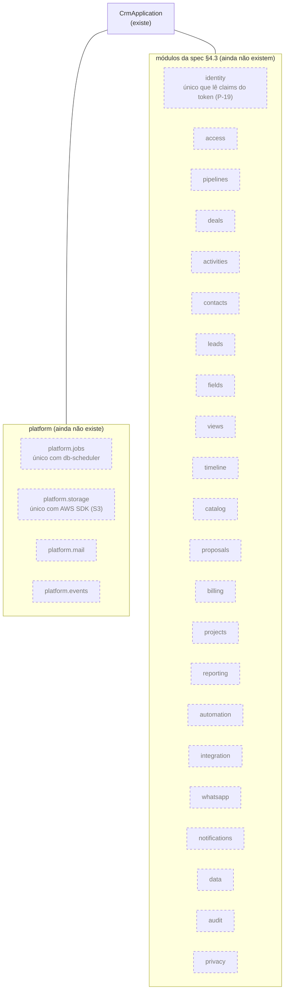

# Módulos do backend

Dono: Arquiteto. Atualizado: 2026-11-24 (story 0-06; backend no commit `27ecdcc`).

**Fonte do que existe:** a linha `[ModularityTest] módulos detectados` que o
`ModularityTest` imprime em `comandos.arquitetura`. Em 2026-11-24 ela diz
`módulos detectados (0): (nenhum: regra sem alvo ainda)`: só existe
`br.com.akeel.crm.CrmApplication`, no pacote raiz. A cada módulo novo, o Arquiteto
confere que esta lista e a do teste batem; divergência é achado.

**Fonte do que vai existir:** spec §4.3 (22 módulos) e ADR 0001, decisão 3
(`platform`, com um subpacote por adaptador). Um pacote de topo fora dessa lista deixa o
`ModularityTest` vermelho.

## Existe

| Módulo | Pacote | Desde |
|---|---|---|
| (nenhum) | só `br.com.akeel.crm` (`CrmApplication`) | 0-05 |

## Ainda não existe

O diagrama não desenha dependências entre módulos de domínio: elas ainda não existem, e
desenhá-las seria descrever o que vai existir. Entram quando o código as criar, conferidas
contra o `ModularityTest`.

## As regras que o teste guarda

| Regra | Teste |
|---|---|
| Sem ciclo entre módulos e sem acesso a pacote interno de outro módulo | `ModularityTest` (`ApplicationModules.verify()`) |
| Pacote de topo só da §4.3 ou `platform` | `ModularityTest` |
| Sem `@Scheduled`; `Timer`, `Executors`, `new Thread` e `Thread.ofVirtual/ofPlatform/startVirtualThread` só em `platform..` | `ArchitectureTest` |
| db-scheduler só em `platform.jobs`; AWS SDK só em `platform.storage` | `ArchitectureTest` |
| `jakarta.persistence` só em pacotes listados (lista vazia) | `ArchitectureTest` |
| Claims do token só em `identity` (ADR 0001, P-19) | `ArchitectureTest` |
| Sem back-channel logout (ADR 0003, emenda §15); sem `com.agui` (ADR 0004) | `ArchitectureTest` |
| Nenhum host de provedor de S3 em `src/main`; `crm.storage.endpoint` sem padrão | `StorageConfigTest` |
