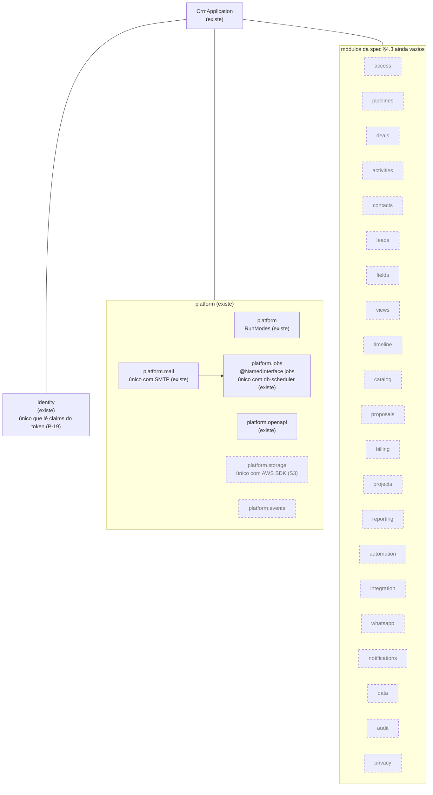

# Módulos do backend

Dono: Arquiteto. Atualizado: 2026-11-25 (depois da 0-11; backend no commit `c07d095`).

**Fonte do que existe:** a linha `[ModularityTest] módulos detectados` que o
`ModularityTest` imprime em `comandos.arquitetura`. Em 2026-11-25, num clone do backend
fixado em `c07d095`, ela diz `[ModularityTest] módulos detectados (2): identity, platform`
(`Tests run: 14, Failures: 0`, `BUILD SUCCESS`). A cada módulo novo, o Arquiteto confere que
esta lista e a do teste batem; divergência é achado. Conferido: batem.

**Fonte do que vai existir:** spec §4.3 (22 módulos) e ADR 0001, decisão 3
(`platform`, com um subpacote por adaptador). Um pacote de topo fora dessa lista deixa o
`ModularityTest` vermelho.

## Existe

| Módulo | Pacote | Desde |
|---|---|---|
| (raiz) | `br.com.akeel.crm` (`CrmApplication`) | 0-05 |
| `identity` | `br.com.akeel.crm.identity` (login BFF, sessão, renovação do token, `GET /api/session`) | 0-09 |
| `platform` | `br.com.akeel.crm.platform` (`RunModes`, `RunModeConfig`: modos `api`, `worker`, `migrate`) | 0-10 |
| `platform` | `br.com.akeel.crm.platform.openapi` (springdoc 3.1.0, `/v3/api-docs`, sem Swagger UI) | 0-08 |
| `platform` | `br.com.akeel.crm.platform.jobs` (fachada do db-scheduler, `@NamedInterface("jobs")`) | 0-10, interface na 0-11 |
| `platform` | `br.com.akeel.crm.platform.mail` (e-mail do sistema por fila, `mail_delivery`) | 0-11 |

Dependências medidas por `import` em `c07d095`: `platform.mail` usa `platform.jobs`
(`JobDefinition`, `JobScheduler`, `RetryPolicy`). `identity` não importa nada de `platform`.

## Existe e vai existir

A única seta é a dependência que o código tem (`platform.mail` → `platform.jobs`). As
dependências entre módulos de domínio entram quando o código as criar, conferidas contra o
`ModularityTest`.

## As regras que o teste guarda

| Regra | Teste |
|---|---|
| Sem ciclo entre módulos e sem acesso a pacote interno de outro módulo | `ModularityTest` (`ApplicationModules.verify()`) |
| Pacote de topo só da §4.3 ou `platform` | `ModularityTest` |
| Sem `@Scheduled`, direto ou meta-anotado; `Timer`, `Executors`, `new Thread` e `Thread.ofVirtual/ofPlatform/startVirtualThread` só em `br.com.akeel.crm.platform..` | `ArchitectureTest` |
| db-scheduler só em `br.com.akeel.crm.platform.jobs..`; AWS SDK só em `br.com.akeel.crm.platform.storage..`; `jakarta.mail` e `org.springframework.mail` só em `br.com.akeel.crm.platform.mail..` | `ArchitectureTest` |
| `jakarta.persistence` só em pacotes listados (lista vazia) | `ArchitectureTest` |
| Claims do token só em `identity` (ADR 0001, P-19) | `ArchitectureTest` |
| Sem back-channel logout (ADR 0003, emenda §15); sem `com.agui` (ADR 0004) | `ArchitectureTest` |
| Nenhum host de provedor de S3 em `src/main`; `crm.storage.endpoint` sem padrão | `StorageConfigTest` |
