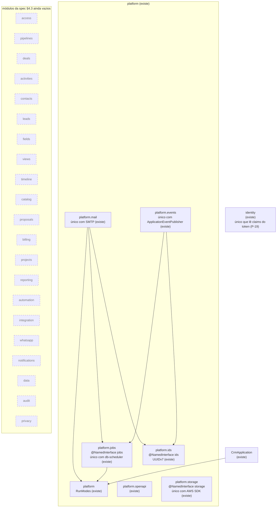

# Módulos do backend

Dono: Arquiteto. Atualizado: 2026-11-25 (portão da Onda 0; backend no commit `46e767a`).

Conferido com o teste de arquitetura em 2026-11-25, commit 46e767a: `[ModularityTest] módulos detectados (2): identity, platform` · `ModularityTest` 2/0 · `StorageConfigTest` 2/0 · `ArchitectureTest` 12/0 · `Tests run: 16, Failures: 0, Errors: 0, Skipped: 0` · `BUILD SUCCESS` · exit 0 (comando `comandos.arquitetura`, clone de diretório único fixado em `46e767a`). Os dois módulos do diagrama (`identity`, `platform`) batem com a lista do teste.

**Fonte do que existe:** a linha `[ModularityTest] módulos detectados` acima, os pacotes de
`src/main/java` e os `import` entre eles, medidos no mesmo clone. A cada módulo novo, o Arquiteto
confere que esta lista e a do teste batem; divergência é achado.

**Fonte do que vai existir:** spec §4.3 (22 módulos) e ADR 0001, decisão 3 (`platform`, com um
subpacote por adaptador). Um pacote de topo fora dessa lista deixa o `ModularityTest` vermelho.

## Existe

| Módulo | Pacote | Desde |
|---|---|---|
| (raiz) | `br.com.akeel.crm` (`CrmApplication`) | 0-05 |
| `identity` | `br.com.akeel.crm.identity` (login BFF, sessão, renovação do token, `GET /api/session`) | 0-09 |
| `platform` | `br.com.akeel.crm.platform` (`RunModes`, `RunModeConfig`: modos `api`, `worker`, `migrate`) | 0-10 |
| `platform` | `br.com.akeel.crm.platform.openapi` (springdoc 3.1.0, `/v3/api-docs`, sem Swagger UI) | 0-08 |
| `platform` | `br.com.akeel.crm.platform.jobs` (fachada do db-scheduler, `RecurringJob`; `@NamedInterface("jobs")`) | 0-10, interface na 0-11, `RecurringJob` na 0-12 |
| `platform` | `br.com.akeel.crm.platform.ids` (`IdGenerator`, UUIDv7; `@NamedInterface("ids")`) | 0-11 (correção N2) |
| `platform` | `br.com.akeel.crm.platform.mail` (e-mail do sistema por fila, `mail_delivery`) | 0-11 |
| `platform` | `br.com.akeel.crm.platform.events` (`DomainEvents.publish` na `outbox_event`, repasse no `worker`, registro do Spring Modulith) | 0-12 |
| `platform` | `br.com.akeel.crm.platform.storage` (`ObjectStorage`: URL pré-assinada, multipart, CORS do bucket; `@NamedInterface("storage")`) | 0-13 |

Dependências medidas por `import br.com.akeel.crm.…` em `46e767a` (nenhuma referência por nome
qualificado fora de `import`, exceto o `META-INF/spring.factories`, que registra
`platform.events.WorkerEventStaleness`):

- `CrmApplication` → `platform` (`RunModes`)
- `platform.jobs` → `platform` (`RunModes`)
- `platform.mail` → `platform` (`RunModes`), `platform.jobs` (`JobDefinition`, `JobScheduler`, `RetryPolicy`), `platform.ids` (`IdGenerator`)
- `platform.events` → `platform.jobs` (`RecurringJob`), `platform.ids` (`IdGenerator`)
- `identity`, `platform.openapi` e `platform.storage` não importam nenhum outro pacote do CRM.

As setas dentro de `platform` ligam subpacotes do **mesmo** módulo: o `ModularityTest` não as
policia (só olha entre módulos). As interfaces nomeadas `jobs`, `ids` e `storage` são o que um
módulo de domínio poderá usar. `platform.mail` (`SystemMail`) e `platform.events`
(`DomainEvents`) não têm `@NamedInterface`. Medido em 2026-11-25 no clone em `46e767a`, com uma
classe de sonda `deals.SondaUso` (campos `DomainEvents` e `SystemMail`), removida depois:
`ModularityTest` vermelho, `Module 'deals' depends on non-exposed type
br.com.akeel.crm.platform.events.DomainEvents within module 'platform'!` e o mesmo para
`SystemMail`. Logo, a primeira story de domínio que publicar evento ou mandar e-mail precisa
declarar `@NamedInterface` em `platform.events` e `platform.mail`. Para `events`, o Revisor achou o
mesmo na reconferência da 0-12 (`reviews/0-12.md` N9, inclusive para o consumidor `DomainEvent`).

## Existe e vai existir

Cada seta é um `import` medido em `46e767a`. Os módulos de domínio aparecem tracejados e sem
seta: nenhum existe. As dependências entre eles entram quando o código as criar, conferidas
contra o `ModularityTest`.

## As regras que o teste guarda

`comandos.arquitetura` roda três classes: `ModularityTest` (2 testes), `ArchitectureTest`
(12 entradas `@ArchTest`) e `StorageConfigTest` (2 testes).

| Regra | Teste |
|---|---|
| Sem ciclo entre módulos e sem acesso a pacote interno de outro módulo | `ModularityTest.modules_verify_without_cycles_or_internal_access` (`ApplicationModules.verify()`) |
| Pacote de topo só da §4.3 ou `platform` | `ModularityTest.every_top_level_package_is_a_module_of_the_spec_or_platform` |
| Sem `@Scheduled`/`@Schedules`, direto ou meta-anotado | `ArchitectureTest.no_scheduled_methods` |
| `Timer`, `Executors`, `new Thread` e `Thread.ofVirtual/ofPlatform/startVirtualThread` só em `platform..` | `ArchitectureTest.no_loose_threads_outside_platform` |
| db-scheduler (`com.github.kagkarlsson..`) só em `platform.jobs..` | `ArchitectureTest.db_scheduler_only_in_platform_jobs` |
| AWS SDK (`software.amazon.awssdk..`) só em `platform.storage..` | `ArchitectureTest.aws_sdk_only_in_platform_storage` |
| `jakarta.mail` e `org.springframework.mail` só em `platform.mail..` | `ArchitectureTest.smtp_only_in_platform_mail` |
| Só `platform.events` depende de `ApplicationEventPublisher` ou chama `publishEvent` (ADR 0002) | `ArchitectureTest.only_platform_events_uses_the_application_event_publisher` |
| Consumidor do envelope `DomainEvent` com `@EventListener`/`@TransactionalEventListener` é `@ApplicationModuleListener` (ADR 0002) | `ArchitectureTest.domain_event_consumers_are_application_module_listeners` |
| `jakarta.persistence` só em pacotes listados (lista vazia) | `ArchitectureTest.jpa_only_in_listed_packages` |
| Claims do token só em `identity` (ADR 0001, P-19) | `ArchitectureTest.only_identity_reads_token_claims` |
| Sem back-channel logout (ADR 0003, emenda §15) | `ArchitectureTest.no_oidc_back_channel_logout` |
| Sem `com.agui` (ADR 0004) | `ArchitectureTest.no_ag_ui_java_sdk` |
| `archRule.failOnEmptyShould` não desligado e a importação acha `CrmApplication` | `ArchitectureTest.archunit_does_not_hide_empty_rules` |
| Nenhum host de provedor de S3 em `src/main` | `StorageConfigTest.no_provider_host_in_src_main` |
| `crm.storage.endpoint` sem padrão nos arquivos de configuração | `StorageConfigTest.storage_endpoint_has_no_default_in_config_files` |
