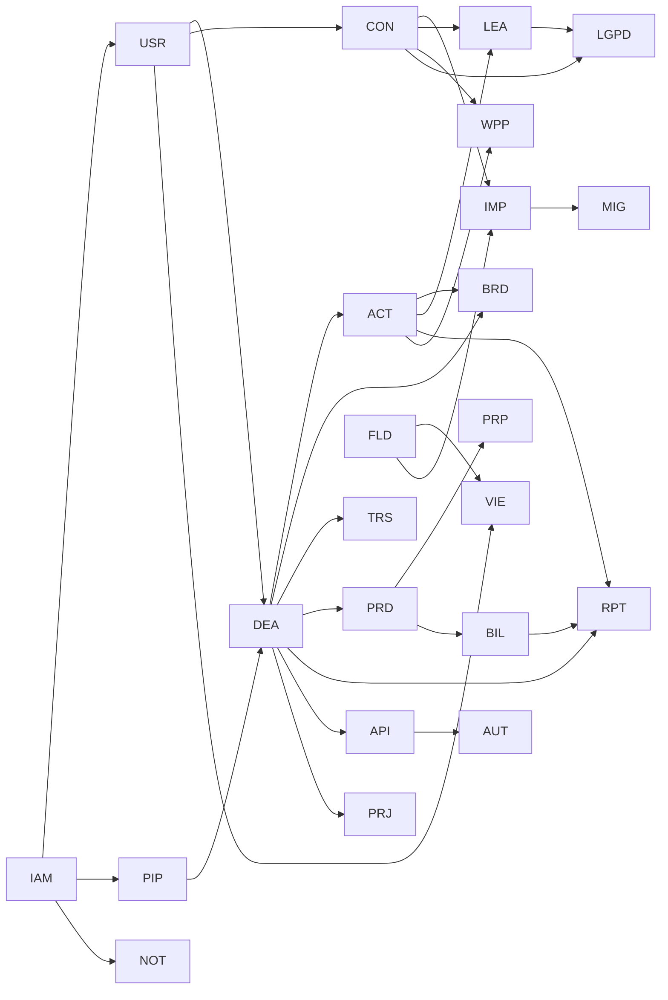
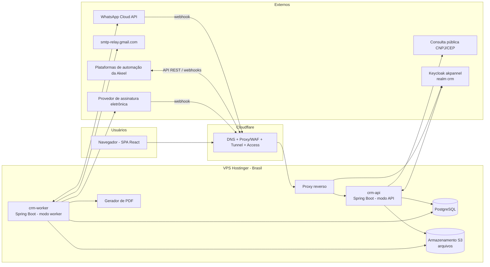
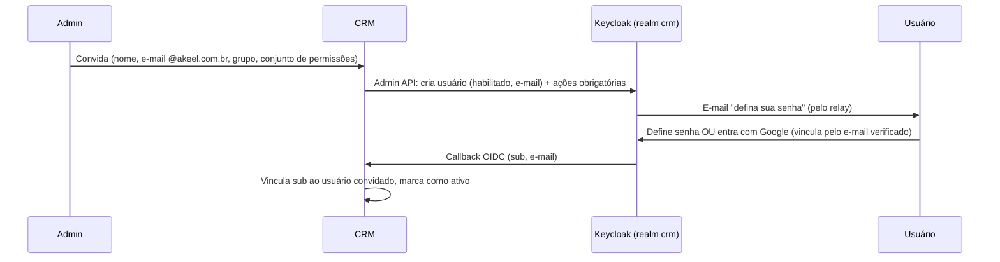
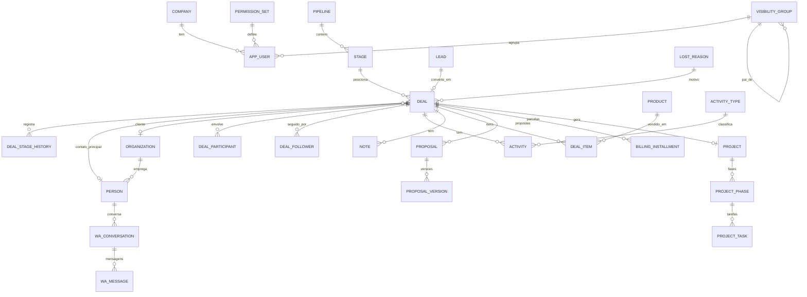

# CRM Akeel: especificação de produto e técnica (v1)

> Documento para o time de desenvolvimento. Versão 1.2 · 24/11/2026 (v1.1 de 23/11/2026; o nome do arquivo continua `-v1.1` para não quebrar as referências) (sem plano de sprints: o planejamento é do time) · Nome do produto provisório: **CRM Akeel**.
>
> Fonte principal: o pacote de estudo do Pipedrive (pasta `pipedrive/`, entregue junto com este documento), as decisões tomadas no planejamento e o projeto de código aberto warpdrive (licença MIT), usado como referência de implementação.

> **Mudanças da v1.2 (24/11/2026), feitas pelo Orquestrador a pedido do Pedro** (`planning/decisoes/2026-11-24.md` §12 e §13):
> - Keycloak: realm próprio **`crm`** em `akpannel.akeel.com.br`, fora da VPS do CRM, no lugar do realm `sed` (D-07, §4.1, §5.1, §5.2, P-15).
> - Clientes, claims e conta de serviço do realm registrados em §5.1 e §5.2.
> - Dois conflitos novos foram **decididos pelo Pedro em 24/11**: P-18 (mantém o BFF; falta a TI criar um cliente confidencial de login) e P-19 (o CRM continua mandando nos papéis e sincroniza o grupo `/Perfis/*` no Keycloak).
> - Respostas parciais registradas em P-12 (identidade provisória) e P-17 (arquivos e backup).
> - Realm `crm` entregue pela TI em 24/11 (Keycloak 26.8.2): clientes `crm-bff` e `crm-bff-dev` criados, sessão confirmada (§5.1, P-18). A configuração do Keycloak é ponto de partida: o time pode pedir mudanças à TI (`decisoes §15`).
> - Decisões técnicas que não mudam o produto ficam nos ADRs (`docs/adr/`), não aqui.

## Sumário

0. [Como usar este documento](#0-como-usar-este-documento)
1. [Visão do produto](#1-visão-do-produto)
2. [Decisões registradas](#2-decisões-registradas)
3. [Escopo da v1 e mapa de módulos](#3-escopo-da-v1-e-mapa-de-módulos)
4. [Arquitetura técnica](#4-arquitetura-técnica)
5. [Identidade, segurança e permissões](#5-identidade-segurança-e-permissões)
6. [Modelo de dados](#6-modelo-de-dados)
7. [Núcleo de vendas: regras de negócio](#7-núcleo-de-vendas-regras-de-negócio)
8. [Núcleo de vendas: telas](#8-núcleo-de-vendas-telas)
9. [Módulos da v1](#9-módulos-da-v1)
10. [Integrações e eventos](#10-integrações-e-eventos)
11. [Requisitos não funcionais](#11-requisitos-não-funcionais)
12. [Estratégia de testes](#12-estratégia-de-testes)
13. [Definition of Ready e Definition of Done](#13-definition-of-ready-e-definition-of-done)
14. [Pendências e especificações a produzir](#14-pendências-e-especificações-a-produzir)
15. [Fora da v1 (roadmap)](#15-fora-da-v1-roadmap)
- [Apêndice A: testes de paridade](#apêndice-a-testes-de-paridade-t-001-a-t-046)
- [Apêndice B: melhorias sobre o Pipedrive](#apêndice-b-melhorias-sobre-o-pipedrive-b-001-a-b-011)
- [Apêndice C: glossário](#apêndice-c-glossário)
- [Apêndice D: referências](#apêndice-d-referências)

---

## 0. Como usar este documento

### 0.1 Convenções de identificadores

| Prefixo | Significado | Origem |
|---|---|---|
| `R-xxx` | Regra **observada no Pipedrive**, com evidência | Pacote `pipedrive/rules/` |
| `T-xxx` | Teste de paridade de uma regra R | Pacote `pipedrive/clone/parity.md` e [Apêndice A](#apêndice-a-testes-de-paridade-t-001-a-t-046) |
| `B-xxx` | Problema encontrado no Pipedrive que **corrigimos de propósito** | Pacote `pipedrive/findings.md` e [Apêndice B](#apêndice-b-melhorias-sobre-o-pipedrive-b-001-a-b-011) |
| `S-xxx`, `C-xxx`, `FL-xxx`, `E-xxx`, `EV-xxx` | Tela, componente, fluxo, entidade e evidência (print, captura de rede) do pacote | Pacote `pipedrive/` |
| `Q-xxx`, `BR-xxx` | Pergunta em aberto e barreira regulatória do pacote | Pacote `pipedrive/` |
| `D-xx` | Decisão do projeto | [Seção 2](#2-decisões-registradas) |
| `RF-<MÓD>-nn` | Requisito funcional **nosso** (proposto ou decidido) | Este documento |
| `RNF-nn` | Requisito não funcional | [Seção 11](#11-requisitos-não-funcionais) |
| `P-xx` | Pendência que precisa ser resolvida antes de implementar o que depende dela | [Seção 14](#14-pendências-e-especificações-a-produzir) |

A diferença entre `R` e `RF` importa:
- **R** descreve o que o Pipedrive faz, com evidência no pacote.
- **RF** descreve o que **nós** vamos construir. Onde o RF diverge de um R, o documento diz "difere de propósito" e aponta o B correspondente.

### 0.2 Status de especificação de cada módulo

| Selo | Significado | O que o time faz |
|---|---|---|
| ✅ **Especificado** | Regras com evidência no pacote + decisões fechadas | Pode ser implementado |
| 🟡 **Base definida** | Requisitos deste documento são suficientes para começar; detalhes de comportamento serão confirmados numa sessão de estudo (seção 14.2) ou com o PO | Pode ser implementado depois do refinamento |
| 🔴 **Depende de pendência** | Há uma decisão `P-xx` aberta que muda o desenho | Não deve ser implementado até a pendência fechar |

### 0.3 Prioridade dentro da v1 (MoSCoW)

- **Must:** sem isso a Akeel não larga o Pipedrive.
- **Should:** esperado na v1; pode escorregar para logo após a entrada em produção sem bloquear a virada.
- **Could:** entra se houver capacidade.

### 0.4 Princípios que valem para todo o time

1. **O alvo funcional é o Pipedrive, com as personalizações da Akeel.** Comportamento parecido, **marca, textos, ícones e identidade visual próprios.** Não copiar textos de interface do Pipedrive literalmente (os testes do Apêndice A estão reescritos em termos de comportamento por isso).
2. **A regra central do produto:** todo negócio aberto deve ter uma próxima atividade. Ela é aplicada **no domínio (backend)**, não só na tela, e vale para a interface, a API, as automações e as integrações.
3. **Toda mudança relevante gera um evento de domínio** (seção 4.4). Webhooks, automações, notificações, auditoria, tempo real e relatórios consomem esses eventos.
4. **Nada é apagado de imediato.** Exclusões vão para a lixeira por 30 dias (exceto quando dito o contrário).
5. **Português do Brasil e real (BRL) em tudo**, com formatos brasileiros consistentes.
6. **Permissões e visibilidade são aplicadas no backend**, em toda consulta, incluindo busca, listas, relatórios, exportações e API.

### 0.5 Para agentes de IA que usam este documento

- Leia a seção 0 e a seção 2 (decisões) antes de qualquer módulo. Depois, carregue só a seção do módulo em que está trabalhando, mais as seções 5 (permissões) e 6 (modelo de dados).
- Cite os identificadores (`RF`, `R`, `T`, `D`) em commits, testes e pull requests.
- **Não invente respostas para pendências `P-xx` nem implemente módulos 🔴.** Pare e pergunte a uma pessoa.
- Onde um `RF` diz "difere de propósito", implemente o comportamento do `RF`, não o do Pipedrive.
- As evidências estão em `pipedrive/` (texto e imagens). Os diagramas deste documento estão em Mermaid (texto).

---

## 1. Visão do produto

### 1.1 Objetivo

Construir o CRM interno da Akeel, uma consultoria, para substituir o Pipedrive que a empresa usa hoje. O produto deve:
- reproduzir o modelo de trabalho do Pipedrive (funil visual, atividades e a regra da próxima atividade);
- cobrir o ciclo comercial completo de uma consultoria: captação de leads, negociação, catálogo de serviços, propostas, previsão de receita, cronograma de cobrança e passagem para a entrega (projetos);
- conversar com as plataformas de automação da Akeel por API e webhooks;
- ter WhatsApp integrado ao fluxo de vendas;
- corrigir os problemas do Pipedrive encontrados no estudo (Apêndice B).

### 1.2 Usuários

| Perfil | O que faz no CRM |
|---|---|
| **Vendedor / consultor comercial** | Trabalha o funil, agenda e conclui atividades, conversa por WhatsApp, monta propostas |
| **Gestor comercial** | Acompanha o funil da equipe, previsão, metas, relatórios, aprova descontos |
| **Administrador** | Configura funis, campos, permissões, automações, integrações, importações |
| **Entrega / projetos** | Recebe o projeto criado a partir do negócio ganho e acompanha fases e tarefas |
| **Plataformas de automação** (sistema) | Leem e escrevem dados pela API; recebem eventos por webhook |

### 1.3 Premissas de volume (para dimensionamento)

Uso interno de uma empresa. Premissas a confirmar com o PO (P-11):

| Item | Premissa |
|---|---|
| Usuários ativos | até 50 |
| Negócios abertos por funil | até 2.000 |
| Pessoas + organizações | até 100.000 |
| Atividades | até 500.000 |
| Mensagens de WhatsApp por mês | até 50.000 |

### 1.4 O que torna este CRM diferente do Pipedrive

- WhatsApp como canal nativo, ligado a contato, negócio e linha do tempo.
- Integração direta com as plataformas internas (API, webhooks, contas de serviço).
- Campos e validações brasileiros (CPF, CNPJ com consulta pública, CEP, telefone +55).
- Catálogo de serviços e propostas pensados para consultoria (hora, escopo fechado, mensalidade).
- Correções de comportamento: próxima atividade sugerida pela etapa, pergunta sobre atividades abertas ao fechar um negócio, quadro que se reordena na hora, português consistente.
- Dados hospedados na infraestrutura da Akeel, no Brasil.

---

## 2. Decisões registradas

| ID | Tema | Decisão |
|---|---|---|
| D-01 | Uso | **Interno da Akeel (uma empresa).** Escalar para outras empresas não está previsto, mas o modelo guarda uma entidade `company` para não fechar essa porta (seção 6.1) |
| D-02 | Moeda | **Só BRL.** Todo valor monetário guarda também o código da moeda (`currency = 'BRL'`), sem conversão |
| D-03 | Backend | **Java 25 + Spring Boot 4**, monólito modular (seção 4) |
| D-04 | Frontend | **React + TypeScript + Vite, SPA** (seção 4.2) |
| D-05 | Banco | **PostgreSQL** (17 ou superior) |
| D-06 | Infraestrutura | **VPS na Hostinger, no Brasil**, atrás do **Cloudflare** (DNS, proxy, Tunnel e Access) |
| D-07 | Login | **Keycloak, realm `crm`**, em `https://akpannel.akeel.com.br` (v1.2; antes: realm `sed`): login com senha própria ou com Google, restrito a contas do domínio `akeel.com.br`. Detalhes em §5.1 |
| D-08 | Cadastro de usuários | **Somente por convite** do administrador na v1. Cadastro aberto (endpoint público) fica para o futuro |
| D-09 | Fonte de verdade | O **CRM** é a fonte de verdade de perfil, papéis e permissões. O Keycloak só autentica. **Confirmado na v1.2 (P-19):** quando o papel muda no CRM, o CRM troca o grupo `/Perfis/*` do usuário pela Admin API, para o Keycloak ficar coerente; a autorização do CRM não lê o claim `roles` |
| D-10 | E-mail do sistema | **Relay SMTP do Google Workspace** (seção 10.4), remetente `Akeel <no-reply@akeel.com.br>` |
| D-11 | E-mail de vendas e agenda | **Fora da v1.** Será resolvido depois que a aplicação estiver pronta (seção 15). Recomendação registrada: Gmail API + Calendar API com OAuth por usuário, app interno do Workspace |
| D-12 | WhatsApp | **Entra na v1**, pela API oficial da Meta (Cloud API), com a conta da própria Akeel |
| D-13 | Visibilidade | **Os 4 níveis do Pipedrive** (R-048) |
| D-14 | Visões do funil | **Quadro, lista, previsão e arquivo** |
| D-15 | Histórico de etapas | **Tabela própria** (`deal_stage_history`) |
| D-16 | Escopo da v1 | Inclui automações, leads e captação, produtos/serviços, propostas, previsão, relatórios, projetos simples e cronograma de cobrança |
| D-17 | Faturamento | **Sem ERP na v1.** O CRM gera o cronograma de cobrança e emite eventos para um ERP futuro. Emissão de NFS-e fica fora do CRM |
| D-18 | Projetos | **Módulo simples na v1** (fases e tarefas). Apontamento de horas, Gantt e alocação ficam fora (ver P-05) |
| D-19 | Migração | **Migração da conta atual do Pipedrive pela API v2**, ensaiada antes da virada |
| D-20 | Mobile | **Fora da v1.** A interface deve ser utilizável em tablet; telas de celular ficam para depois |
| D-21 | Marketing | **Mautic no futuro**, com provedor de envio e subdomínio próprios. Nunca pelo relay do Workspace |
| D-22 | Referência de implementação | **warpdrive** (MIT) como referência de modelo de dados, regras e, no frontend, de código reaproveitável (com aviso de copyright). Não usar o backend dele (stack diferente) |
| D-23 | Decisões do estudo | As perguntas Q-002 a Q-009 e Q-018 do pacote estão decididas neste documento (seção 7.10) |

---

## 3. Escopo da v1 e mapa de módulos

### 3.1 Mapa de módulos

| Código | Módulo | Prioridade | Depende de | Spec | Referência warpdrive |
|---|---|---|---|---|---|
| IAM | Identidade e acesso (Keycloak, sessão, convites) | Must | — | ✅ | — |
| USR | Usuários, grupos de visibilidade, conjuntos de permissões | Must | IAM | 🟡 | `src/features/permissions`, `src/db/schema/identity.ts` |
| PIP | Funis e etapas (editor) | Must | IAM | ✅ | `src/features/pipelines` |
| DEA | Negócios: criação, página, ganho, perda, reabertura | Must | PIP, USR | ✅ | `src/features/deals`, `deal-workspace` |
| BRD | Visões do funil: quadro, lista, previsão, arquivo | Must | DEA, ACT | ✅ quadro · 🟡 lista, previsão, arquivo | `src/features/deals` |
| ACT | Atividades, próxima atividade, lista, calendário, contador | Must | DEA | ✅ formulário e regra · 🟡 lista e calendário | `src/features/activities` |
| NOT | Notificações e e-mails do sistema | Must | IAM | 🟡 | `src/features/notifications` |
| TRS | Lixeira, restauração e auditoria | Must | DEA | ✅ exclusão · 🟡 restauração e auditoria | `src/db/schema/changeLogs.ts` |
| CON | Pessoas e organizações | Must | USR | 🟡 | `src/features/contacts` |
| FLD | Campos personalizados | Must | — | 🟡 | `src/features/custom-fields` |
| VIE | Listas, filtros, visões salvas, busca, edição em massa | Must | FLD, USR | 🟡 | `src/features/saved-filters`, `search` |
| IMP | Importação e exportação | Must | CON, FLD | 🟡 | `src/features/import` |
| MIG | Migração do Pipedrive | Must | IMP, DEA, ACT, PRD | 🔴 P-06 | `src/features/import` (sinônimos Pipedrive) |
| LEA | Leads, captação e formulários | Must | CON, ACT | 🟡 | `src/features/leads` |
| PRD | Produtos e serviços, itens no negócio | Must | DEA | 🟡 | — |
| PRP | Propostas | Must | PRD | 🔴 P-03 | — |
| BIL | Cronograma de cobrança | Should | PRD | 🟡 | — |
| RPT | Relatórios, painéis, metas | Must | DEA, ACT, PRD, BIL | 🔴 P-04 | `src/features/goals`, `stats` |
| API | API pública, tokens, webhooks | Must | Núcleo + eventos | 🟡 | `src/features/oauth`, `mcp` |
| AUT | Automações | Must | API (eventos) | 🔴 P-01 | — |
| WPP | WhatsApp | Must | CON, ACT | 🔴 P-02 | `src/features/x-dms` (padrão de caixa compartilhada) |
| PRJ | Projetos | Should | DEA | 🔴 P-05 | — |
| LGPD | Proteção de dados no produto | Must | CON, LEA | 🟡 | — |
| UI | Interface transversal: adição rápida, atalhos, busca global, tempo real | Must | — | ✅ adição rápida · 🟡 resto | `src/features/shortcuts`, `quick-add`, `realtime` |

### 3.2 Ordem de dependência entre os módulos

A ordem de construção e a divisão em sprints são decisões do time. O diagrama só mostra **o que precisa existir antes** de cada módulo: uma seta `A --> B` quer dizer que B usa A.



Observações:
- A fundação técnica (seção 4: CI/CD, Keycloak, outbox e jobs, design system, backups, envio de e-mail) vem antes de qualquer módulo.
- A **migração do Pipedrive** (MIG) precisa ser ensaiada pelo menos duas vezes antes da virada; o prazo final depende de P-07.
- As sessões de estudo da seção 14.2 podem correr em paralelo desde o início, para que os módulos 🟡 e 🔴 cheguem prontos.

### 3.3 Fora da v1

E-mail de vendas (sincronização de caixa, modelos, rastreio), sincronização de agenda, agendador de reuniões, sequências de acompanhamento, Mautic, aplicativo mobile, integração com ERP e emissão de NFS-e, chatbot e chat ao vivo, apontamento de horas, multimoeda, telefonia VoIP, assistente de IA, cadastro aberto de usuários. Detalhes na [seção 15](#15-fora-da-v1-roadmap).

---

## 4. Arquitetura técnica

### 4.1 Visão geral



- **Um repositório de backend, um artefato, dois modos de execução:** `api` (atende HTTP) e `worker` (jobs, eventos, integrações). Mesmo código, processos separados, para que um job pesado não afete a interface.
- **Monólito modular:** módulos de negócio com fronteiras verificadas em teste. Nada de microsserviços na v1.
- **Tudo em contêineres** (Docker Compose) na VPS.

### 4.2 Stack

| Camada | Escolha | Observação |
|---|---|---|
| Linguagem | Java 25 (LTS) | |
| Framework | Spring Boot 4 + Spring Modulith | Modulith verifica fronteiras entre módulos e oferece registro de publicação de eventos (outbox) |
| Acesso a dados | **jOOQ** (consultas, filtros dinâmicos, relatórios) | JPA/Hibernate só onde trouxer ganho claro; evitar carregamento preguiçoso em listas e quadro |
| Migrações | Flyway | Migrações sempre compatíveis com a versão anterior do código (deploy sem parada) |
| Jobs | JobRunr ou db-scheduler (decidir no início do projeto) | Persistidos no PostgreSQL. **Proibido** usar cron do sistema ou threads soltas para regras de negócio |
| Segurança | Spring Security: OAuth2 Client (login BFF) + Resource Server (API pública) | Seção 5 |
| Contrato da API | OpenAPI 3.1 (springdoc), cliente TypeScript gerado | Fonte única de verdade entre front e back |
| Tempo real | Server-Sent Events + `LISTEN/NOTIFY` do PostgreSQL | |
| Busca | PostgreSQL: `pg_trgm` + `unaccent` + `tsvector` com configuração `portuguese` | Sem Elasticsearch na v1 |
| Arquivos | Armazenamento compatível com S3 na VPS (ex.: Garage ou SeaweedFS), com backup fora da VPS | Decidir no início do projeto (P-17) |
| PDF | Serviço de conversão HTML → PDF em contêiner (ex.: Gotenberg) | Propostas |
| Observabilidade | Micrometer + OpenTelemetry, logs estruturados JSON, Sentry (ou equivalente) para erros | |
| Testes | JUnit 5, Testcontainers (PostgreSQL real), ArchUnit/Modulith, Playwright (e2e) | Seção 12 |
| Frontend | React + TypeScript + Vite (SPA) | |
| Estado e dados no front | TanStack Query (cache, atualização otimista) + TanStack Router | |
| Componentes | Radix UI / shadcn, design system próprio (tokens) | |
| Arrastar e soltar | dnd-kit | Quadro, editor de funil, colunas |
| Formulários | react-hook-form + zod | |
| i18n | Biblioteca de i18n com pt-BR como único idioma da v1 (textos fora do código) | |

### 4.3 Módulos do backend

| Módulo | Responsabilidade |
|---|---|
| `identity` | Usuários, convites, sincronização com Keycloak, sessões, preferências |
| `access` | Grupos de visibilidade, conjuntos de permissões, construtor de predicados SQL de visibilidade |
| `pipelines` | Funis, etapas, configurações de etapa (probabilidade, apodrecimento, próximo passo padrão, campos obrigatórios) |
| `deals` | Negócios, histórico de etapas, participantes, seguidores, etiquetas, motivos de perda |
| `activities` | Atividades, tipos, regra da próxima atividade, contador, lembretes |
| `contacts` | Pessoas, organizações, relações, deduplicação e mesclagem, consulta CNPJ/CEP |
| `leads` | Leads, formulários de captação, conversão, distribuição |
| `fields` | Definições de campos personalizados e validação |
| `views` | Filtros, visões salvas, colunas, busca, edição em massa |
| `timeline` | Notas, comentários, arquivos, linha do tempo unificada |
| `catalog` | Produtos e serviços, itens no negócio |
| `proposals` | Modelos, propostas, versões, PDF, assinatura |
| `billing` | Cronograma de cobrança |
| `projects` | Projetos, fases, tarefas, modelos |
| `reporting` | Relatórios, painéis, metas, previsão |
| `automation` | Regras de automação e execuções |
| `integration` | API pública, tokens, webhooks de saída e de entrada |
| `whatsapp` | Contas, conversas, mensagens, templates |
| `notifications` | Notificações internas, e-mails do sistema, resumo diário |
| `data` | Importação, exportação, migração do Pipedrive, lixeira, purga |
| `audit` | Log de alterações por campo e log de segurança |
| `privacy` | Bases legais, consentimentos, pedidos de titulares |

### 4.4 Eventos de domínio e outbox

- Toda operação que muda estado relevante grava, **na mesma transação**, um evento na tabela `outbox_event` (ou no registro de publicação do Spring Modulith).
- O `worker` distribui os eventos para: webhooks de saída, automações, notificações, tempo real (SSE), auditoria e atualização de campos calculados.
- Cada evento tem `id` (UUIDv7), `type`, `occurred_at`, `actor` (usuário, token, automação ou sistema), `entity_type`, `entity_id`, `payload` (estado depois da mudança e campos alterados) e `correlation_id` (para rastrear cadeias de automação).
- O catálogo de eventos está na seção 10.1.

### 4.5 Ambientes e deploy

| Ambiente | Onde | Dados | E-mail |
|---|---|---|---|
| Local | Máquina do desenvolvedor (Docker Compose) | Dados fictícios gerados | Capturador local (ex.: Mailpit). O relay só funciona saindo da VPS |
| Homologação | VPS (contêineres separados, banco separado) ou segunda VPS | **Somente dados fictícios ou anonimizados.** Nunca cópia da produção (LGPD) | Capturador, ou relay restrito a endereços internos |
| Produção | VPS Hostinger, Brasil | Reais | Relay do Workspace |

**Pipeline de CI/CD:**
1. Build e testes (unitários, integração com Testcontainers, arquitetura).
2. Análise estática e de dependências (OWASP Dependency-Check ou equivalente; `npm audit` no front).
3. Build das imagens de contêiner.
4. Deploy em homologação + testes e2e.
5. Deploy em produção com aprovação manual: migrações Flyway como etapa própria, depois troca das instâncias.

**Rede:**
- A VPS não expõe portas de aplicação à internet: o tráfego entra pelo **Cloudflare Tunnel**.
- O painel interno fica atrás do **Cloudflare Access**. *(v1.2: o Keycloak está em `akpannel.akeel.com.br`, operado pela TI da Akeel e fora da VPS do CRM; a proteção do console dele é responsabilidade da TI.)*
- Endpoints públicos necessários: SPA, API, callback do Keycloak, webhooks (WhatsApp, assinatura eletrônica, plataformas) e páginas públicas (formulários, visualização de proposta).

### 4.6 Backups

| Item | Política |
|---|---|
| PostgreSQL | Backup completo diário + arquivamento contínuo do WAL (ex.: pgBackRest), **cópia fora da VPS** em provedor com dados no Brasil |
| Arquivos (S3) | Replicação diária fora da VPS |
| Keycloak | *(v1.2)* Fora do escopo do CRM: o Keycloak em `akpannel` é operado e copiado pela TI da Akeel. O backup do CRM cobre só o PostgreSQL do CRM e os arquivos |
| Objetivos | RPO ≤ 15 min · RTO ≤ 4 h |
| Teste de restauração | **Mensal**, documentado. Backup sem restauração testada não conta |
| Retenção | 35 dias (diários) + 12 mensais. Conflito com pedidos de exclusão de titulares tratado na política de retenção (P-08) |

---

## 5. Identidade, segurança e permissões

### 5.1 Autenticação (Keycloak, realm `crm`)

> Atualizado na v1.2 com a configuração informada pelo Pedro em 24/11/2026. O que está marcado *(provisório)* pode mudar. Os conflitos com o desenho original foram decididos em **P-18** (BFF mantido) e **P-19** (o CRM manda nos papéis), §14.1.

**Servidor e realm:**
- Keycloak **26.8.2** fora da VPS do CRM: `https://akpannel.akeel.com.br`, realm **`crm`**, operado pela TI da Akeel. O nome do realm vem de configuração (`KEYCLOAK_REALM=crm`) e nunca é fixo no código.
- Issuer: `https://akpannel.akeel.com.br/realms/crm`.
- Discovery: `https://akpannel.akeel.com.br/realms/crm/.well-known/openid-configuration` (endpoints de autorização, token, JWKS e logout).
- Domínio do front: `https://crm.akeel.com.br` *(provisório)*.

**Clientes configurados no realm:**

| client_id | Tipo | Uso |
|---|---|---|
| `crm-web` | Público, sem secret. Authorization Code + PKCE `S256`, `scope=openid` | Configurado pela TI na primeira versão. **Pela P-18, o CRM não usa este cliente** |
| `crm-web-dev` | Público | Desenvolvimento local: aceita `http://localhost:5173` e `http://localhost:3000` |
| `crm-api` | Confidencial, grant `client_credentials` (conta de serviço) | Admin API (§5.2, RF-IAM-02). Também é a audiência que a API exige no JWT |
| `crm-bff` | **Confidencial**, Authorization Code com **PKCE `S256` obrigatório** (sem PKCE: `Missing parameter: code_challenge_method`) | Login do BFF em produção. Redirect cadastrado: `https://crm.akeel.com.br/login/oauth2/code/keycloak` |
| `crm-bff-dev` | Confidencial, mesmas regras do `crm-bff` | Desenvolvimento local: aceita qualquer caminho em `localhost:8080`, `5173` e `3000` |

- O access token dura **5 minutos** e é renovado pelo refresh token.
- Logout pelo endpoint `end_session`, com `id_token_hint` e `post_logout_redirect_uri`.
- Os secrets de `crm-bff`, `crm-bff-dev` e `crm-api` chegam por canal seguro e **nunca** entram em repositório. Entram por variável de ambiente (ADR 0003).
- **Sessão no realm (confirmada pela TI em 24/11):** SSO Session Idle **8 h**, SSO Session Max **30 dias**, *Revoke Refresh Token* desligado. O refresh token vale enquanto a sessão estiver ativa.
- **Mesmo domínio:** `crm.akeel.com.br` serve a SPA e o BFF atrás do mesmo proxy (`/api/`, `/oauth2/authorization/`, `/login/oauth2/code/` e `/logout` vão para o backend). Sem CORS e sem cookie em `.akeel.com.br` (ADR 0003).
- **Sem backchannel logout na v1:** a sessão encerrada no Keycloak derruba a do CRM em até 5 min, quando o refresh falha (ADR 0003).
- **Logout:** o `id_token_hint` passa pelo navegador no redirecionamento do `end_session`. É uma exceção estreita ao "tokens só no servidor", aceita pelo Pedro (`decisoes §15`), porque o id_token não dá acesso à API.

**Validação do JWT na API:**
- Issuer acima e assinatura conferida pelo JWKS do discovery.
- `aud` precisa conter `crm-api`.
- Claim `roles`: lista simples, já com os papéis de baixo incluídos (um gestor recebe `gestor`, `vendedor` e `visualizador`). Valores possíveis: `admin`, `gestor`, `vendedor`, `visualizador`.
- Claim `groups`: caminho completo do grupo, ex.: `/Equipes/Comercial`.
- `preferred_username` é o próprio e-mail.

**Desenho do login: BFF, confirmado pela P-18 em 24/11/2026** (é o que os ADRs 0001 e 0003, aceitos, implementam). O cliente público `crm-web` **não** é usado para login, porque deixaria tokens no navegador:

- O CRM é um **cliente confidencial** no realm. *(v1.1 dizia realm `sed`.)*
- **Padrão BFF (Backend for Frontend):**
  - o backend faz o fluxo OIDC Authorization Code + PKCE;
  - os tokens ficam **só no servidor**;
  - a SPA recebe um cookie de sessão `HttpOnly`, `Secure`, `SameSite=Lax`;
  - proteção CSRF em toda requisição que altera dados;
  - **nenhum token no `localStorage`.**
- **Login com Google:** provedor de identidade Google configurado no Keycloak, **restrito ao domínio `akeel.com.br`** (configuração de domínio hospedado do provedor). O backend confere de novo o domínio do e-mail no primeiro login.
- **MFA:** obrigatório para administradores (OTP do Keycloak); opcional para os demais (P-09 decide se vira obrigatório para todos).
- Sessão inativa expira em 8 horas; sessão absoluta em 30 dias (ajustável).

### 5.2 Ciclo de vida do usuário



- **RF-IAM-01** Só e-mails `@akeel.com.br` podem ser convidados na v1.
- **RF-IAM-02** O CRM usa uma **conta de serviço** no Keycloak com a permissão mínima de gerenciar usuários do realm. Na v1.2:
  - cliente `crm-api`, grant `client_credentials`; base da Admin API: `https://akpannel.akeel.com.br/admin/realms/crm`;
  - pode buscar e criar usuários, colocar usuários em grupos e enviar o e-mail de convite; **não** pode alterar o realm nem dar permissão de admin do Keycloak;
  - no Keycloak, o papel de cada usuário vem do **grupo** em que ele está: `/Perfis/Administradores`, `/Perfis/Gestores`, `/Perfis/Vendedores` ou `/Perfis/Visualizadores`. **Não se atribuem papéis direto no usuário.** Pela P-19, o CRM decide o papel e mantém esse grupo em sincronia ao convidar e ao mudar o papel;
  - grupos: `GET /groups?search=...`;
  - convite: `PUT /users/{id}/execute-actions-email?client_id=crm-bff&redirect_uri=https://crm.akeel.com.br/`, com o corpo `["UPDATE_PASSWORD","VERIFY_EMAIL"]`. O link vale **72 h**. Um `redirect_uri` fora dos cadastrados no `crm-bff` devolve 400.
- **RF-IAM-03** Login de alguém que não foi convidado mostra uma tela "acesso não liberado" e registra o evento no log de segurança. Nenhum usuário é criado automaticamente.
- **RF-IAM-04** **Desativar** um usuário no CRM:
  - desativa no Keycloak e encerra as sessões ativas;
  - abre o assistente de transferência (RF-USR-08);
  - libera o acesso, mas **preserva todo o histórico**.
- **RF-IAM-05** Reenviar convite, cancelar convite e redefinir senha (dispara a ação do Keycloak).

### 5.3 Autorização em camadas

| Camada | O que controla | Onde |
|---|---|---|
| 1. Autenticação | Quem é o usuário | Keycloak |
| 2. Conjunto de permissões | O que o usuário pode **fazer** (criar, editar, excluir, exportar, administrar) | `access`, checado em todo caso de uso |
| 3. Visibilidade por registro | O que o usuário pode **ver** (4 níveis + seguidores + grupos) | Predicado SQL gerado pelo módulo `access`, aplicado em toda consulta |
| 4. Visibilidade de funil | Quais funis cada grupo vê | `access` + `pipelines` |
| 5. Permissão por campo (Should) | Quais campos o usuário vê ou edita | `fields` + `access` |
| 6. Escopo de token | O que uma integração pode fazer | `integration` |

**Regra de implementação:** existe **um único** construtor de predicado de visibilidade, usado por listas, quadro, busca, relatórios, exportação, API e automações. Ele tem testes de paridade: para um conjunto de dados de teste, o resultado do filtro SQL tem de ser idêntico ao da checagem em código ("este usuário pode ver este registro?"). Essa técnica vem do warpdrive (`src/features/permissions/sqlParityFixtures.ts`).

### 5.4 Os 4 níveis de visibilidade (R-048, D-13)

Aplicam-se a negócio, lead, pessoa, organização, produto e projeto.

| Valor | Nome na interface | Quem vê |
|---|---|---|
| `OWNER` | Dono | O dono, administradores, seguidores do item e usuários dos grupos **acima** do grupo do dono |
| `OWNER_GROUP` | Grupo do dono (**padrão**) | Todos do grupo de visibilidade do dono + grupos acima + administradores + seguidores |
| `OWNER_GROUP_AND_SUBGROUPS` | Grupo do dono e subgrupos | Acima + todos os grupos abaixo do grupo do dono |
| `EVERYONE` | Todos | Todos os usuários ativos |

- **Grupos de visibilidade** formam uma **árvore** (`parent_id`). Cada usuário pertence a exatamente um grupo.
- O padrão de um item novo é `OWNER_GROUP` (R-039), configurável por empresa.
- **Visibilidade de funil:** cada funil tem a lista de grupos que o veem. Usuário sem acesso ao funil não vê os negócios dele, mesmo com visibilidade `EVERYONE`.
- Atividades, notas e arquivos herdam a visibilidade do item a que estão ligados. Atividade sem negócio, lead ou contato é visível ao dono, ao responsável e aos administradores.

### 5.5 Conjuntos de permissões

Baseados no catálogo do warpdrive (`src/constants/permissionFlags.ts`), ampliados para os módulos da v1.

**Permissões globais:**

| Chave | Permite |
|---|---|
| `deal.create`, `lead.create`, `contact.create`, `activity.create`, `product.create`, `project.create` | Criar itens |
| `bulk.edit` | Edição em massa |
| `data.import`, `data.export` | Importar e exportar |
| `filter.share` | Compartilhar filtros e visões |
| `stats.viewOthers` | Ver relatórios de outros usuários |
| `pipeline.manage` | Criar e editar funis e etapas |
| `metadata.manage` | Campos, tipos de atividade, motivos de perda, etiquetas |
| `product.manage` | Catálogo de produtos e preços |
| `proposal.template.manage` | Modelos de proposta |
| `discount.approve` | Aprovar descontos acima do limite |
| `goals.manage` | Metas |
| `automation.manage` | Automações |
| `integration.manage` | Tokens de API, webhooks, WhatsApp, formulários |
| `permissions.manage` | Usuários, grupos e conjuntos de permissões |
| `trash.manage` | Restaurar itens de outros usuários |
| `privacy.manage` | Pedidos de titulares e consentimentos |

**Permissões por propriedade** (cada uma em três escopos: `_own`, `_team` = grupo, `_any`): `deal.edit`, `deal.delete`, `deal.changeOwner`, `contact.edit`, `contact.delete`, `contact.merge`, `activity.edit`, `activity.delete`, `record.share`.

**Conjuntos padrão** criados na instalação:
- **Administrador:** tudo.
- **Gestor:** tudo de vendas com escopo `_team`, mais relatórios de outros, metas e aprovação de desconto.
- **Vendedor:** criação e edição `_own`, sem exclusão em massa nem exportação.

Permissões marcadas como de alto risco (`permissions.manage`, `integration.manage`, `data.export`, `bulk.edit`, `automation.manage`) exigem confirmação ao serem concedidas e ficam registradas no log de segurança.

### 5.6 Tokens e integrações

- **Plataformas de automação** autenticam como **clientes do Keycloak com conta de serviço** (grant `client_credentials`). Cada cliente é ligado a um **usuário de integração** no CRM, com o próprio conjunto de permissões e grupo de visibilidade. Tudo o que ele faz aparece na auditoria com o nome da integração.
- **Tokens pessoais de API** (Could): gerados pelo usuário, com escopos, validade e armazenados só como hash.
- Limite de taxa por cliente (RNF-08).

### 5.7 Requisitos de segurança

- **RF-SEC-01** Checklist OWASP ASVS nível 2 como critério de aceite de segurança.
- **RF-SEC-02** Cabeçalhos de segurança: CSP restritiva, HSTS, `X-Content-Type-Options`, `frame-ancestors 'none'`, exceto nas páginas públicas que precisem ser embutidas (formulários).
- **RF-SEC-03** Segredos (credenciais do banco, Keycloak, Meta, assinatura) em arquivo de segredos do Docker ou cofre. Nunca no repositório.
- **RF-SEC-04** Tokens de terceiros (WhatsApp, e futuramente Google) **criptografados** no banco (criptografia de envelope com chave fora do banco).
- **RF-SEC-05** Log de segurança (seção 9.17): login e falhas (eventos do Keycloak), convites, mudanças de permissão, exportações, edições em massa, exclusões, uso de tokens, alterações em automações e integrações.
- **RF-SEC-06** **Relay SMTP:** só os contêineres que enviam e-mail têm saída liberada para a porta 587 (seção 10.4).
- **RF-SEC-07** Pentest externo antes da entrada em produção.

---

## 6. Modelo de dados

### 6.1 Convenções

- **Chaves primárias:** `uuid` (UUIDv7, gerado na aplicação). Toda tabela de negócio tem `company_id uuid not null` referenciando a única linha de `company` (D-01). Sem lógica de multiempresa na v1, só o campo.
- **Datas e horas:** `timestamptz` em UTC. "Hoje", "atrasado" e agrupamentos por dia são calculados **no fuso do usuário** (`app_user.time_zone`, padrão `America/Sao_Paulo`).
- **Dinheiro:** `numeric(14,2)` + `currency char(3) default 'BRL'`. No Java, `BigDecimal`. Nunca `double`.
- **Exclusão:** `deleted_at timestamptz` e `deleted_by`. Purga definitiva por job após 30 dias.
- **Arquivamento:** `archived_at timestamptz` onde aplicável.
- **Auditoria:** `created_at`, `created_by`, `updated_at`, `updated_by` em toda tabela de negócio.
- **Campos personalizados:** coluna `custom_fields jsonb not null default '{}'` com índice GIN, valores validados contra `custom_field_def` (seção 9.6).
- **Busca:** colunas geradas com o texto normalizado (`unaccent` + minúsculas) e índices trigram/GIN.
- **Visibilidade:** `owner_id`, `visibility` (enum de 4 valores) e, quando denormalizado para desempenho, `visibility_group_id` (grupo do dono no momento).

### 6.2 Diagrama do núcleo



### 6.3 Tabelas do núcleo

#### `company`
`id`, `name`, `default_currency` (`BRL`), `default_time_zone` (`America/Sao_Paulo`), `settings jsonb`. Contém as configurações da empresa:
- visibilidade padrão de itens novos;
- motivos de perda livres permitidos (sim/não);
- acompanhamento pós-ganho (tipo e prazo);
- tempo de lixeira (30 dias);
- limite de desconto sem aprovação.

#### `app_user`
| Coluna | Tipo | Observação |
|---|---|---|
| `id` | uuid | |
| `keycloak_sub` | text unique null | Preenchido no primeiro login |
| `email` | citext unique | `@akeel.com.br` |
| `name`, `avatar_url` | text | |
| `status` | enum `INVITED`, `ACTIVE`, `INACTIVE` | |
| `is_admin` | boolean | |
| `permission_set_id` | uuid | |
| `visibility_group_id` | uuid | Um grupo por usuário |
| `time_zone` | text | Padrão `America/Sao_Paulo` |
| `is_integration` | boolean | Usuário técnico de uma integração |
| `last_seen_at`, `invited_at`, `invited_by` | | |

#### `visibility_group`
`id`, `name`, `parent_id` (árvore), `order`.

#### `permission_set`
`id`, `name`, `flags jsonb` (chaves da seção 5.5), `is_default`.

#### `user_preference`
`user_id`, `key`, `value jsonb`. Exemplos:
- ordenação do quadro por funil;
- campos extras no card (até 7 por funil, conforme a documentação do Pipedrive SRC-003);
- colunas de cada lista;
- funil padrão;
- "não mostrar a celebração de ganho".

#### `pipeline`
| Coluna | Tipo | Observação |
|---|---|---|
| `id`, `name`, `order` | | |
| `deal_probability_enabled` | boolean | Permite probabilidade por negócio |
| `visible_group_ids` | uuid[] | Visibilidade do funil (vazio = todos) |
| `deleted_at` | | |

#### `stage`
| Coluna | Tipo | Observação |
|---|---|---|
| `id`, `pipeline_id`, `name`, `order` | | |
| `probability` | smallint 0–100 | Padrão 100 (R-041) |
| `rotting_enabled` | boolean | |
| `rotting_days` | smallint ≥ **1** | **Difere de propósito** de R-042 (B-007) |
| `next_step_activity_type_id` | uuid null | **Próximo passo padrão** da etapa (B-002) |
| `next_step_offset_days` | smallint null | Prazo sugerido em dias |
| `required_field_keys` | text[] | Campos obrigatórios para **entrar** na etapa (R-030) |

#### `deal`
| Coluna | Tipo | Observação |
|---|---|---|
| `id`, `title` | | Título livre, aceita emoji e textos longos (até 255) |
| `value`, `currency` | numeric, char(3) | Calculado pelos itens quando houver itens (RF-PRD-06) |
| `status` | enum `OPEN`, `WON`, `LOST` | |
| `pipeline_id`, `stage_id` | uuid | FK composta garante etapa do mesmo funil |
| `owner_id` | uuid | |
| `person_id`, `organization_id` | uuid null | Ao menos um dos dois (R-037) |
| `probability` | smallint null | Só se o funil permitir |
| `expected_close_date` | date null | |
| `won_at`, `lost_at`, `closed_at` | timestamptz null | |
| `lost_reason_id` | uuid null | |
| `lost_reason_text` | text null | **Cópia do texto do motivo** no momento da perda, ou texto livre se permitido |
| `visibility` | enum | Padrão `OWNER_GROUP` |
| `source`, `source_detail` | text | Origem (lead, formulário, importação, API, WhatsApp, manual) |
| `utm` | jsonb | |
| `stage_entered_at` | timestamptz | Entrada na etapa atual |
| `last_action_at` | timestamptz | Última ação que zera o apodrecimento (seção 7.4) |
| `next_activity_id` | uuid null | **Denormalizado**: atividade aberta mais próxima |
| `next_activity_due_at` | timestamptz null | |
| `next_activity_all_day` | boolean null | |
| `board_rank` | numeric | Posição manual (se a ordenação manual for usada) |
| `mrr`, `arr` | numeric null | Calculados dos itens recorrentes |
| `label_ids` | uuid[] | |
| `custom_fields` | jsonb | |
| `archived_at`, `deleted_at` | | |

Índices principais:
- `(pipeline_id, stage_id, status) where deleted_at is null and archived_at is null`;
- `(owner_id)`;
- `(next_activity_due_at)`;
- `(expected_close_date)`;
- GIN em `custom_fields` e em `label_ids`;
- trigram no título normalizado.

#### `deal_stage_history` (D-15)
| Coluna | Tipo | Observação |
|---|---|---|
| `id`, `deal_id` | | |
| `pipeline_id`, `stage_id` | | |
| `entered_at` | timestamptz | |
| `left_at` | timestamptz null | Nulo = etapa atual |
| `moved_by` | uuid null | Usuário, automação ou integração |
| `source` | enum `USER`, `AUTOMATION`, `API`, `IMPORT`, `MIGRATION` | |

- Uma linha aberta por negócio (`left_at is null`), garantida por índice único parcial.
- Alimenta a barra de etapas (R-031), o tempo médio por etapa, a conversão entre etapas e a previsão.
- Negócio criado direto numa etapa posterior: grava linhas com duração zero para as etapas anteriores, reproduzindo o comportamento de R-031 (etapas anteriores verdes com "0 dias").

#### `deal_participant`
`deal_id`, `person_id`, `role` (texto livre: decisor, influenciador, financeiro…), `is_primary`.

#### `deal_follower`
`deal_id`, `user_id`, `followed_at`. O dono segue por padrão.

Seguidores existem também para pessoa, organização, lead e projeto: tabela genérica `follower(entity_type, entity_id, user_id)`.

#### `label`
`id`, `entity_type`, `name`, `color`.

#### `lost_reason`
`id`, `name`, `order`, `active`. Até 100 motivos (SRC-011).

#### `activity_type`
`id`, `key`, `name`, `icon`, `order`, `active`, `is_system`. Tipos iniciais:
- Ligação;
- Reunião;
- Tarefa;
- Prazo;
- E-mail;
- Almoço;
- **WhatsApp**.

#### `activity`
| Coluna | Tipo | Observação |
|---|---|---|
| `id`, `type_id`, `subject` | | |
| `due_at` | timestamptz null | Início. **Difere** do Pipedrive, que separa data e hora UTC (R-019) |
| `all_day` | boolean | Atividade sem horário |
| `end_at` | timestamptz null | |
| `busy` | boolean | Padrão `true` quando tem horário, `false` sem horário (R-019) |
| `priority` | enum null | Baixa, média, alta |
| `done`, `done_at`, `done_by` | | |
| `owner_id` | uuid | Quem criou ou é dono |
| `assignee_id` | uuid | Responsável (aparece na agenda e no contador) |
| `deal_id`, `lead_id`, `person_id`, `organization_id`, `project_id` | uuid null | No máximo um entre negócio, lead e projeto |
| `location`, `video_call_url` | text null | |
| `note` | text (HTML sanitizado) | |
| `recurrence_rule` | text null | RRULE (RF-ACT-12) |
| `recurrence_parent_id` | uuid null | |
| `outcome` | text null | Resultado (ex.: "Atendeu", "Não atendeu") |
| `source` | enum | `USER`, `NEXT_STEP_PROMPT`, `AUTOMATION`, `API`, `WHATSAPP`, `IMPORT` |
| `custom_fields` | jsonb | |
| `deleted_at` | | |

Tabelas relacionadas:
- `activity_participant(activity_id, person_id, is_primary)`;
- `activity_guest(activity_id, email, user_id null)` (convites ficam para depois da v1, junto com a agenda).

#### `note`
`id`, `content` (HTML sanitizado), `deal_id`/`lead_id`/`person_id`/`organization_id`/`project_id`, `pinned` (fixada no Foco), `author_id`, `deleted_at`.

#### `comment`
`id`, `entity_type`, `entity_id` (nota, atividade), `content`, `author_id`, `mentions uuid[]`.

#### `file`
`id`, `storage_key`, `name`, `mime_type`, `size_bytes`, `sha256`, `entity_type`, `entity_id`, `uploaded_by`, `deleted_at`. Limite padrão de 25 MB por arquivo.

#### `person`
| Coluna | Observação |
|---|---|
| `id`, `name`, `first_name`, `last_name` | |
| `organization_id` | Organização principal |
| `emails jsonb` | Lista `{value, label, primary}` |
| `phones jsonb` | Lista `{e164, display, label, primary, whatsapp}`. Normalizado em E.164 (+55) |
| `job_title`, `cpf` | CPF opcional, validado |
| `owner_id`, `visibility`, `label_ids`, `custom_fields` | |
| `marketing_status` | enum: sem consentimento, inscrito, descadastrado |
| `legal_basis` | enum: consentimento, legítimo interesse, execução de contrato, outra |
| `last_action_at`, `next_activity_*` | Mesmos campos calculados do negócio |
| `deleted_at`, `anonymized_at` | |

Índices: GIN em `emails` e `phones` para deduplicação e para casar mensagens do WhatsApp pelo telefone.

#### `organization`
| Coluna | Observação |
|---|---|
| `id`, `name` (nome fantasia), `legal_name` (razão social) | |
| `cnpj` | Único quando preenchido, validado |
| `address jsonb` | CEP, logradouro, número, complemento, bairro, cidade, UF |
| `website`, `segment`, `cnae` | |
| `owner_id`, `visibility`, `label_ids`, `custom_fields` | |
| `deleted_at` | |

Relações: `organization_relation(from_id, to_id, type)` com tipos matriz/filial, parceira, controlada.

#### `lead`
`id`, `title`, `person_id`, `organization_id`, `value`, `expected_close_date`, `owner_id`, `visibility`, `source`, `source_detail`, `utm jsonb`, `form_submission_id`, `label_ids`, `custom_fields`, `next_activity_*`, `converted_deal_id`, `converted_at`, `archived_at`, `deleted_at`.

### 6.4 Tabelas dos demais módulos

| Tabela | Colunas principais |
|---|---|
| `custom_field_def` | `id`, `entity_type`, `key` (estável, gerada uma vez), `name`, `type`, `options jsonb`, `required`, `important`, `show_in_create_form`, `group_name`, `order`, `visible_permission_set_ids`, `editable_permission_set_ids`, `archived_at` |
| `saved_view` | `id`, `entity_type`, `name`, `filter jsonb` (árvore de condições), `columns jsonb`, `sort jsonb`, `owner_id`, `shared`, `favorite` |
| `product` | `id`, `code`, `name`, `description`, `category`, `unit` (hora, dia, mês, projeto, unidade), `billing_type` (único, recorrente), `billing_frequency` (mensal, trimestral, semestral, anual), `default_cycles`, `price`, `currency`, `tax_note`, `active`, `visibility`, `custom_fields` |
| `deal_item` | `id`, `deal_id`, `product_id` (nulo = item avulso), `description`, `quantity`, `unit`, `unit_price`, `discount_type` (percentual, valor), `discount_value`, `total` (calculado), `billing_type`, `billing_frequency`, `cycles`, `start_date`, `order` |
| `proposal_template` | `id`, `name`, `content` (HTML com variáveis), `default_validity_days`, `active` |
| `proposal` | `id`, `deal_id`, `number` (sequencial legível, ex.: `PROP-2026-0001`), `status`, `current_version_id`, `owner_id` |
| `proposal_version` | `id`, `proposal_id`, `version`, `content_snapshot`, `items_snapshot jsonb`, `total`, `valid_until`, `pdf_file_id`, `sent_at`, `first_viewed_at`, `accepted_at`, `rejected_at`, `rejection_reason`, `signature_request_id`, `public_token_hash` |
| `discount_approval` | `id`, `proposal_version_id`, `requested_by`, `approver_id`, `status`, `decided_at`, `comment` |
| `billing_installment` | `id`, `deal_id`, `deal_item_id`, `description`, `due_date`, `amount`, `status` (previsto, faturado, pago, cancelado), `invoiced_at`, `paid_at`, `external_ref` (ERP futuro) |
| `project` | `id`, `title`, `deal_id`, `organization_id`, `owner_id`, `status`, `start_date`, `due_date`, `template_id`, `visibility`, `custom_fields` |
| `project_phase` | `id`, `project_id`, `name`, `order` |
| `project_task` | `id`, `project_id`, `phase_id`, `title`, `description`, `assignee_id`, `due_date`, `done`, `done_at`, `order` |
| `project_template` | `id`, `name`, `phases jsonb` (fases e tarefas com prazos relativos) |
| `goal` | `id`, `name`, `metric`, `target`, `period`, `start_date`, `assignee_type` (usuário, grupo, empresa), `assignee_id`, `pipeline_id`, `activity_type_id` |
| `dashboard` / `dashboard_widget` | `id`, `name`, `owner_id`, `shared`; widgets com `report_type`, `config jsonb`, `position` |
| `automation` | `id`, `name`, `trigger jsonb`, `conditions jsonb`, `actions jsonb`, `active`, `created_by`, `version` |
| `automation_run` | `id`, `automation_id`, `event_id`, `status`, `started_at`, `finished_at`, `steps jsonb`, `error`, `depth` |
| `webhook_subscription` | `id`, `name`, `url`, `event_types text[]`, `secret_encrypted`, `active`, `failure_count`, `disabled_at` |
| `webhook_delivery` | `id`, `subscription_id`, `event_id`, `attempt`, `status_code`, `response_ms`, `next_attempt_at`, `delivered_at` |
| `inbound_event` | `id`, `source` (whatsapp, assinatura, plataforma), `external_id` (único por origem), `payload jsonb`, `received_at`, `processed_at`, `error` |
| `outbox_event` | Seção 4.4 |
| `wa_account` | `id`, `waba_id`, `phone_number_id`, `display_phone`, `token_encrypted`, `status` |
| `wa_conversation` | `id`, `account_id`, `contact_e164`, `person_id`, `assignee_id`, `last_inbound_at` (janela de 24 h), `status` (aberta, resolvida) |
| `wa_message` | `id`, `conversation_id`, `wamid` (único), `direction`, `type`, `body`, `media_file_id`, `template_name`, `status` (enviada, entregue, lida, falhou), `sent_by`, `sent_at`, `deal_id` |
| `wa_template` | `id`, `account_id`, `name`, `language`, `category`, `components jsonb`, `status` |
| `web_form` | `id`, `name`, `fields jsonb`, `consent_text`, `consent_version`, `target` (lead), `default_owner_id`, `distribution`, `success_message`, `redirect_url`, `active` |
| `form_submission` | `id`, `form_id`, `data jsonb`, `utm jsonb`, `ip_hash`, `consent_given`, `consent_version`, `created_lead_id`, `received_at` |
| `consent_record` | `id`, `person_id`, `purpose`, `legal_basis`, `source`, `text_version`, `granted_at`, `revoked_at` |
| `privacy_request` | `id`, `person_id`, `type` (acesso, correção, exclusão/anonimização, portabilidade), `status`, `requested_at`, `due_at`, `completed_at`, `handled_by` |
| `notification` | `id`, `user_id`, `type`, `entity_type`, `entity_id`, `payload`, `read_at` |
| `notification_preference` | `user_id`, `type`, `in_app`, `email` |
| `import_batch` / `import_row` / `external_id` | Lote, linhas intermediárias com status e erros, mapeamento de IDs externos (Pipedrive → CRM) |
| `change_log` | `id`, `entity_type`, `entity_id`, `field`, `old_value jsonb`, `new_value jsonb`, `actor_type`, `actor_id`, `occurred_at` |
| `security_log` | `id`, `type`, `actor_id`, `ip`, `details jsonb`, `occurred_at` |

---

## 7. Núcleo de vendas: regras de negócio

**Status: ✅ Especificado.** Cada RF aponta para a regra observada (R), o teste (T) e, quando diverge de propósito, a melhoria (B). As evidências (prints e capturas de rede) estão no pacote, em `pipedrive/evidence/`.

### 7.1 Estado da próxima atividade

**RF-ACT-01 Próxima atividade de um negócio.** É a atividade **aberta, não excluída e de menor `due_at`** ligada ao negócio.
- Desempate: atividade "dia inteiro" antes de atividade com horário no mesmo dia (R-004); depois, a criada primeiro.
- Os campos `next_activity_*` do negócio são atualizados **na mesma transação** de qualquer criação, edição, conclusão, exclusão ou restauração de atividade.
- Valem as mesmas regras para lead, pessoa e organização.

**RF-ACT-02 Estado do próximo passo** (`next_step_state`), calculado no fuso do usuário que está vendo (R-001, R-002):

| Estado | Condição | Indicador no card |
|---|---|---|
| `OVERDUE` (atrasado) | `due_at` antes de hoje, **ou** hoje com horário já passado (R-002) | Vermelho, seta "<" |
| `TODAY` (hoje) | Hoje, dia inteiro ou com horário ainda não passado | Verde, seta ">" |
| `FUTURE` (futuro) | Depois de hoje | Cinza, seta ">" |
| `NONE` (sem próximo passo) | Negócio aberto sem atividade aberta | Amarelo, triângulo de alerta |

- **Melhoria:** o estado é exposto em **todas** as visões (quadro, lista, página do negócio, API, webhooks), não só no card.
- Testes: T-001, T-002.

### 7.2 Ordenação padrão do quadro

**RF-BRD-01** Ordenação "Próxima atividade (padrão)" dentro de cada etapa (R-003, R-004, R-005):
1. Por estado: `OVERDUE`, `TODAY`, `NONE`, `FUTURE`.
2. Dentro de `OVERDUE` e `FUTURE`: `next_activity_due_at` crescente.
3. Dentro de `TODAY`: primeiro as de dia inteiro, depois por horário crescente (R-004).
4. Empate: o negócio **criado mais recentemente** primeiro (R-005).

Testes: T-003, T-004, T-005.

**RF-BRD-02 (difere de propósito: B-006)** Depois de uma mudança feita pelo usuário (concluir atividade no popover, criar negócio, mudar data), o card **se reposiciona na hora**, com uma animação curta, em vez de esperar a página recarregar (R-006).
- Um negócio recém-criado aparece no topo com o selo **NOVO** por 10 segundos e depois vai para a posição que a ordenação define.
- Mudanças vindas de outros usuários (tempo real) também reordenam, **exceto enquanto o usuário estiver arrastando um card**.
- Teste: T-006 (comportamento melhorado).

**RF-BRD-03** Outras ordenações disponíveis, guardadas por usuário e por funil:
- título;
- valor;
- valor ponderado;
- data prevista de fechamento;
- data de criação;
- última atualização;
- última ação;
- dono;
- organização;
- pessoa;
- tempo na etapa;
- dias sem ação.

Direção crescente ou decrescente. Lista final a confirmar (P-14). O Pipedrive oferece 14 opções (EV-026).

### 7.3 Valor ponderado

**RF-BRD-04** O cabeçalho da etapa mostra a **soma ponderada** dos negócios abertos e a contagem (R-007):
- valor ponderado = `valor × probabilidade ÷ 100`;
- a probabilidade do negócio, quando o funil permite e o campo está preenchido, substitui a da etapa.

O rodapé ou a barra do funil mostra o total do funil, com alternância entre valor total e ponderado. Teste: T-007, com os exemplos numéricos do pacote (ex.: etapa a 10% com 1.000 + 30.000 + 0 + 1.234.567,89 → R$ 126.556,79 · 4 negócios).

### 7.4 Apodrecimento (negócio parado)

**RF-PIP-05** Uma etapa com apodrecimento ligado e **N dias (mínimo 1; difere de propósito de R-042, B-007)** marca o negócio como parado quando `agora − última referência ≥ N dias`. A última referência é `last_action_at` ou, se ela for anterior à entrada na etapa, `stage_entered_at`. Visual:
- card com fundo rosado;
- selo vermelho "Nd" com dica "Sem ações há N dias" (R-008).

Teste: T-008 adaptado para N = 1.

**RF-PIP-06 (decisão sobre Q-008)** O que zera o apodrecimento (atualiza `last_action_at`):
- atividade concluída;
- nota criada;
- arquivo anexado;
- mensagem de WhatsApp enviada ou recebida no negócio ou no contato principal;
- proposta enviada;
- mudança de etapa.

Editar campos **não** zera.

### 7.5 Regra da próxima atividade

**RF-ACT-03** Concluir uma atividade quando **ainda há outras abertas** no negócio:
- risca a atividade;
- mostra uma confirmação curta ("Atividade concluída");
- **não** abre o modal;
- o indicador do card passa para a próxima atividade (R-013).

Teste: T-013.

**RF-ACT-04** Concluir a **última** atividade aberta de um negócio ou de um lead abre o modal **"Agendar próxima atividade"**, já ligado ao negócio, à organização e à pessoa (R-014). Vale para conclusões:
- pelo popover do card;
- pelo Foco da página do negócio;
- pela lista de atividades;
- pelo calendário.

Decisão sobre Q-007: vale também para leads. Para atividades ligadas **só** a pessoa ou organização, o modal **não** abre. O modal abre em **até 300 ms** (sem a espera de 2 a 3 segundos observada). Teste: T-014.

**RF-ACT-05** **Cancelar** o modal não cria nada (R-015):
- o card fica com o indicador amarelo;
- o Foco do negócio mostra o estado vazio com o botão "+ Agendar atividade".

A regra **não bloqueia** o vendedor; ela deixa o problema visível. Teste: T-015.

**RF-ACT-06 (difere de propósito: B-002)** Valores sugeridos no modal (R-016 descreve o comportamento original):

| Campo | Regra de sugestão, em ordem de prioridade |
|---|---|
| Tipo | 1) Próximo passo padrão da etapa atual (`stage.next_step_activity_type_id`); 2) o tipo da atividade que acabou de ser concluída; 3) o primeiro tipo ativo da lista |
| Data | Hoje + `stage.next_step_offset_days` (se definido); senão, hoje |
| Horário | Vazio (dia inteiro) |
| Disponibilidade | Livre (vira Ocupado ao escolher horário) |
| Assunto | Vazio; o placeholder é o nome do tipo |
| Responsável | Usuário atual |
| Vínculos | Negócio, organização e pessoa do negócio |

Teste: T-016 (comportamento melhorado).

**RF-ACT-07** Ao clicar no horário de início, o formulário preenche o **próximo intervalo de 15 minutos** e muda a disponibilidade para Ocupado. A agenda do dia, ao lado do formulário, mostra o bloco novo (R-017). Teste: T-017.

**RF-ACT-08** Salvar o modal cria a atividade (`source = NEXT_STEP_PROMPT`), mostra a confirmação "Atividade criada · Ver" e a atividade aparece no Foco (R-018). Teste: T-018.

**RF-ACT-09** Padrões de atividade criada pela API (R-019):
- `busy = true` quando tem horário e `false` sem horário;
- participantes vazio quando não há pessoa.

O armazenamento usa `due_at` + `all_day` (seção 6.3). Teste: T-019 adaptado.

**RF-ACT-10** Na página do negócio:
- atividades atrasadas no Foco mostram selo vermelho **ATRASADA** e a data relativa em vermelho, ex.: "Ontem às 10:00" (R-020);
- atividades concluídas saem do Foco e entram no Histórico com check verde, e o filtro do Histórico atualiza a contagem (R-021).

Testes: T-020, T-021.

**RF-ACT-11 Regra no domínio.** A API marca `next_step_state = NONE` em negócios e leads sem próximo passo, e o evento `deal.next_step_missing` é emitido quando um negócio aberto fica sem atividade aberta. Automações e integrações podem reagir a ele.

### 7.6 Contador de atividades

**RF-ACT-13** O item "Atividades" da navegação mostra um contador igual ao número de atividades **abertas do usuário (como responsável)** que estão **atrasadas ou vencem hoje** (R-012).
- Atualiza em tempo real ao criar, concluir, excluir ou quando uma atividade vence (virada do dia no fuso do usuário).
- Teste: T-012, com a sequência do pacote: criar 1 atrasada + 3 de hoje soma 4; concluir uma de hoje subtrai 1; concluir uma de hoje e criar outra de hoje no modal mantém o número.

### 7.7 Criação de negócio

**RF-DEA-01** O formulário "Novo negócio" exige **título** e **pessoa ou organização**. Sem uma das duas, os dois campos mostram "Informe uma pessoa ou organização" e o botão Salvar fica desabilitado (R-037). Teste: T-037.

**RF-DEA-02** No campo Organização, texto que não corresponde exatamente a uma organização existente (comparação sem acento e sem diferenciar maiúsculas):
- mostra o selo **NOVA**;
- oferece "Adicionar «texto» como nova organização".

Escolher uma existente remove o selo (R-038). O mesmo vale para Pessoa. Antes de criar, o sistema mostra possíveis duplicadas pelo CNPJ, e-mail ou telefone (RF-CON-06). Teste: T-038.

**RF-DEA-03** Valores padrão ao abrir o formulário pelo quadro (R-039):
- funil atual;
- primeira etapa (ou a etapa da coluna, se aberto pelo "+" da coluna);
- dono = usuário atual;
- moeda BRL;
- visibilidade = padrão da empresa (grupo do dono).

O formulário mostra os campos personalizados marcados como "mostrar no formulário de criação" e os obrigatórios. Teste: T-039.

**RF-DEA-04** Ao salvar (R-040):
- confirmação "Negócio «título» criado · Ver";
- a página do negócio **não** abre automaticamente;
- o card aparece no topo da etapa com o selo NOVA (ver RF-BRD-02).

Teste: T-040.

**RF-DEA-05** Ao criar um negócio sem atividade, o formulário oferece, opcionalmente, agendar a primeira atividade com as sugestões da etapa (RF-ACT-06). Comportamento próprio, não observado no Pipedrive.

### 7.8 Etapas e barra de etapas

**RF-DEA-06** Clicar numa etapa da barra de etapas move o negócio **na hora, sem confirmação** (R-030).
- Antes de mover, o sistema verifica `stage.required_field_keys` da etapa de destino.
- Se faltar algum campo, abre um pequeno formulário só com os campos faltantes; o negócio só se move quando eles são preenchidos.
- A mesma regra vale para arrastar no quadro, para a API (que responde `422` com a lista de campos) e para automações (que registram falha na execução).

Teste: T-030 adaptado (sem o banner de automação recomendada, ver B-010).

**RF-DEA-07** A barra de etapas mostra os **dias em cada etapa** (`deal_stage_history`):
- etapas já percorridas e a atual em verde, futuras em cinza;
- a dica da etapa atual diz "Nesta etapa há N minutos/horas/dias";
- etapa ainda não visitada diz "Este negócio ainda não passou por esta etapa";
- negócio criado direto na terceira etapa mostra as anteriores com "0 dias" (R-031).

Teste: T-031.

**RF-DEA-08** Voltar para uma etapa anterior é permitido. Gera nova linha no histórico, conta tempo de novo e não apaga as passagens anteriores.

**RF-DEA-09** Mover o negócio para **outro funil** pelo menu ou pela zona "Mover para" do quadro: o usuário escolhe funil e etapa de destino. O histórico registra a troca de funil.

### 7.9 Ganho, perda e reabertura

**RF-DEA-10** **Ganho** é um clique, sem confirmação (R-022). O negócio passa a `WON`, `won_at` é gravado e a interface mostra:
- selo GANHO;
- botão Reabrir;
- barra de etapas verde-clara;
- "Criar projeto" destacado;
- data de ganho nos detalhes.

Teste: T-022.

**RF-DEA-11 (difere de propósito: B-004)** Se o negócio tiver **atividades abertas** ao ser ganho ou perdido, o sistema pergunta o que fazer com elas: **manter abertas**, **marcar como concluídas** ou **excluir**, com a lista das atividades.

| Ação | Padrão |
|---|---|
| Ganho | Manter abertas |
| Perda | Excluir |

A escolha vale para todas as atividades da lista; o usuário pode desmarcar individualmente. Pela API, o parâmetro `open_activities` (`keep`, `complete`, `delete`) define o comportamento, com padrão igual à interface. Teste: T-025 (comportamento melhorado).

**RF-DEA-12** Celebração de ganho (R-023): um modal com o card do negócio, data de fechamento e atividades concluídas, e a pergunta "Qual o próximo passo?" com:
- "Agendar acompanhamento";
- "Criar projeto";
- "Não mostrar novamente" (preferência do usuário).

**Difere de propósito (B-011):** o modal abre **imediatamente**; os números carregam de forma assíncrona. Teste: T-023 adaptado.

**RF-DEA-13 (difere de propósito: B-001)** "Agendar acompanhamento" abre o formulário de atividade com o contexto de pós-ganho e **respeita a configuração da empresa** (`company.settings.won_follow_up`: tipo e prazo, ex.: Ligação em 3 meses) (R-024). Teste: T-024 (comportamento melhorado).

**RF-DEA-14** **Reabrir** um negócio ganho ou perdido o devolve a `OPEN` na hora, na mesma etapa (R-026):
- os botões Ganho e Perdido voltam;
- a data de fechamento sai dos detalhes;
- o histórico registra a reabertura.

Teste: T-026.

**RF-DEA-15** **Perda** exige motivo (R-027). Sem motivo, o seletor fica com borda vermelha e nada é enviado. Teste: T-027.

**RF-DEA-16 (difere de propósito: B-005)** Motivos de perda (R-028):
- com a configuração "permitir motivo livre" **ligada**, o usuário pode escolher da lista **ou** digitar um texto novo (oferecido como "Usar «texto» como motivo");
- com ela **desligada**, só a lista.

O texto do motivo é sempre copiado para `lost_reason_text`. Teste: T-028 (comportamento melhorado).

**RF-DEA-17** O comentário da perda vira uma **nota fixada** no negócio (R-029):
- aparece no Foco (amarelo) e no Histórico;
- os detalhes mostram data e motivo da perda.

Teste: T-029.

### 7.10 Exclusão, lixeira e decisões sobre as perguntas do estudo

**RF-TRS-01 (difere de propósito: B-003)** Excluir um negócio (R-032):
- **Diálogo:** lista o que vai junto: notas, arquivos, propostas, parcelas de cobrança **e atividades**. Para atividades abertas, aplica a pergunta de RF-DEA-11 (padrão: excluir).
- **Página do negócio excluído:** faixa com a data de exclusão definitiva (30 dias), selo EXCLUÍDO, botão **Restaurar**, compositor bloqueado.
- **Restauração:** restaura juntos os itens excluídos **na mesma operação**.

Teste: T-032 (comportamento melhorado).

**RF-TRS-02** Atividades de um negócio excluído podem ser excluídas individualmente pela página dele (R-033). Teste: T-033.

**RF-TRS-03 (decisão)** Excluir uma **nota** pede confirmação e manda para a lixeira (restaurável por 30 dias). O Pipedrive diz "não pode ser desfeito" (R-034); nós mantemos a consistência da lixeira. Teste: T-034 adaptado.

**RF-TRS-04 (difere de propósito: B-009)** Excluir um funil com negócios (R-035): o diálogo exige escolher **explicitamente**, **sem opção pré-selecionada**, entre:
- "Mover os negócios para outro funil" (exige funil e etapa);
- "Excluir os negócios" (aviso: restauráveis por 30 dias).

O botão fica desabilitado até a escolha estar completa. Teste: T-035 (comportamento melhorado).

**RF-TRS-05** Excluir uma organização (R-036): o diálogo informa que notas e arquivos dela vão para a lixeira e que os demais itens (negócios, pessoas) **permanecem**, sem a organização. Restaurável por 30 dias. Excluir uma pessoa segue a mesma lógica. Teste: T-036.

**RF-TRS-06** Página **Lixeira** (administradores veem tudo; usuários veem o que excluíram):
- filtros por tipo, por quem excluiu e por data;
- restaurar individual ou em massa;
- data de exclusão definitiva;
- job diário de purga após 30 dias, com registro no log de segurança.

**Decisões sobre as perguntas em aberto do estudo:**

| Pergunta | Decisão |
|---|---|
| Q-001 (cliques ignorados) | Não se aplica: era artefato de automação do navegador ou bug do Pipedrive. Requisito: todo botão responde ao primeiro clique |
| Q-002 (restaurar atividades) | **Sim.** Atividades excluídas vão para a lixeira e podem ser restauradas, sozinhas ou junto com o negócio |
| Q-003 (motivo livre) | Configurável por empresa (RF-DEA-16) |
| Q-004 (após salvar funil novo) | O quadro abre **o funil recém-criado** |
| Q-005 (excluir funil padrão do usuário) | Se o funil excluído era o padrão de alguém, o padrão passa para o primeiro funil visível na ordem, e o usuário vê um aviso no próximo acesso |
| Q-006 (o que outro usuário vê) | Seção 5.4 |
| Q-007 (escopo do modal) | RF-ACT-04 |
| Q-008 (o que zera o apodrecimento) | RF-PIP-06 |
| Q-009 (tempo real) | **Sim**, para quadro, página do negócio, listas, contador e notificações (RF-UI-05) |
| Q-018 (acompanhamento pós-ganho) | RF-DEA-13 |
| Q-011 a Q-017 | Eram de SaaS para terceiros; não se aplicam ao uso interno |

### 7.11 Editor de funil

**RF-PIP-01** "Novo funil" abre o editor (R-041) com:
- nome "Novo funil";
- probabilidade por negócio ligada;
- cinco etapas: Qualificado, Contato feito, Reunião agendada, Proposta enviada, Negociação;
- probabilidade 100% em cada uma;
- apodrecimento desligado.

Os nomes padrão podem ser ajustados pelo PO. Teste: T-041 (com nomes em português).

**RF-PIP-02** Cada etapa pode ser editada: nome, probabilidade (0–100, validada), apodrecimento (mínimo 1 dia), próximo passo padrão (tipo + prazo), campos obrigatórios para entrar. Também é possível:
- reordenar etapas arrastando;
- inserir etapa entre duas;
- duplicar funil;
- reordenar funis;
- definir a visibilidade do funil por grupo.

**RF-PIP-03** Excluir uma etapa **vazia** pede confirmação ("Não há negócios nesta etapa") (R-043). Teste: T-043.

**RF-PIP-04** Excluir uma etapa **com negócios** exige escolher a etapa de destino dos negócios (não há exclusão em cascata de negócios por exclusão de etapa).

**RF-PIP-07** Validações: nome obrigatório (funil e etapa); probabilidade inteira de 0 a 100; ao menos uma etapa por funil; nomes de etapa únicos dentro do funil.

**RF-PIP-08** Só usuários com `pipeline.manage` editam funis.

---

## 8. Núcleo de vendas: telas

As telas do Pipedrive estão documentadas com prints anotados no pacote (`pipedrive/screens/`, `pipedrive/components/`). O design do CRM Akeel segue **a mesma estrutura de informação com identidade visual própria**.

### 8.1 Quadro do funil (S-001)

| Região | Conteúdo |
|---|---|
| Barra superior | Seletor de visão (quadro, lista, previsão, arquivo); botão "+ Negócio" com menu de outras criações; contagem "N negócios" com total; seletor de funil (com: outros funis, reordenar, visibilidade do funil, personalizar cards, novo funil); botão editar funil; filtros (visões salvas, por usuário, por etiqueta); barra de filtro rápido; ordenação; "mostrar negócios fechados" |
| Colunas | Uma por etapa, com nome, valor ponderado e contagem; "+" ao passar o mouse para criar negócio na etapa |
| Card (C-001) | Título (quebra em até 3 linhas, sem cortar), organização ou pessoa, avatar do dono, valor, selo de apodrecimento, indicador de próximo passo (C-002) e até 7 campos extras escolhidos pelo usuário |
| Arrastar (R-011) | Ao arrastar, quatro zonas aparecem no rodapé: **Excluir, Perdido, Ganho, Mover para** (outro funil). Soltar em Perdido abre o diálogo de perda; em Ganho, aplica RF-DEA-10 e RF-DEA-11; em Excluir, abre a confirmação. Teste: T-011 |

**Requisitos:**
- **RF-BRD-05** O indicador de próximo passo abre um popover com as atividades abertas (data relativa e círculo de concluir) e "+ Agendar atividade". Sem atividades: "Nenhuma atividade agendada para este negócio" (R-010). Teste: T-010.
- **RF-BRD-06** Negócios ganhos, perdidos, arquivados e excluídos não aparecem no quadro e não entram na contagem (R-009), exceto com "mostrar negócios fechados" ligado. Teste: T-009.
- **RF-BRD-07** Carregamento progressivo: estrutura e colunas primeiro, cards em seguida, sem bloquear a barra (RNF-01).

### 8.2 Visão de lista

**RF-BRD-08** Tabela de negócios do funil (ou de todos os funis), com:
- colunas configuráveis por usuário (inclusive campos personalizados);
- ordenação por coluna;
- filtros e visões salvas (seção 9.7);
- seleção múltipla com edição em massa;
- edição na própria célula;
- exportação;
- a coluna "Próximo passo" com o mesmo indicador de quatro estados.

Paginação por cursor; rolagem infinita com contagem total. Status: 🟡 (estrutura pelo warpdrive, `src/features/deals/dealListColumns.ts`).

### 8.3 Visão de previsão (forecast)

**RF-BRD-09** Colunas por **período** (mês padrão; alternar para semana ou trimestre), agrupando negócios pela **data prevista de fechamento**.
- **Cada coluna mostra:** negócios abertos (valor total e ponderado), negócios ganhos no período, e o total da coluna em relação à meta do período (se houver meta de receita).
- **Arrastar um negócio** para outra coluna muda a `expected_close_date` para o mesmo dia do período de destino (ou o último dia, se não existir) e registra no histórico.
- **Coluna lateral** "Sem data prevista", com os negócios sem data.
- **Filtros:** funil, dono, grupo, etiqueta, visão salva.
- **Receita recorrente:** alternar para "receita recorrente prevista" usa o cronograma de cobrança (seção 9.13).

Status: 🟡. Confirmar detalhes numa sessão de estudo (seção 14.2).

### 8.4 Visão de arquivo

**RF-BRD-10** Lista de negócios **arquivados**:
- "Arquivar" esconde o negócio de todas as visões ativas sem excluí-lo; serve para negócios fechados antigos ou parados;
- ações: desarquivar, excluir, exportar;
- ação em massa "Arquivar negócios fechados há mais de N dias" na lista.

Status: 🟡.

### 8.5 Página do negócio (S-002)

| Região | Conteúdo |
|---|---|
| Cabeçalho | Título editável; dono; seguidores; botão Ganho (com menu "Ganho e criar projeto"); Perdido; menu "..." (duplicar, mover de funil, arquivar, excluir, mesclar com outro negócio, ver alterações); estado do próximo passo |
| Barra de etapas (C-006) | RF-DEA-06 a RF-DEA-08 |
| Coluna lateral: Resumo | Valor (ou itens), probabilidade, pessoa, organização, participantes, etiquetas, data prevista, projeto vinculado, MRR/ARR se houver recorrência |
| Coluna lateral: Detalhes | Campos personalizados (agrupados, com os "importantes" no topo), origem e UTM, datas de ganho e perda, motivo |
| Coluna lateral: Itens | Produtos e serviços do negócio (seção 9.11) |
| Coluna lateral: Pessoas e organização | Cartões com contatos, telefone com botão de WhatsApp, e-mail |
| Compositor (abas) | **Atividade, Nota, WhatsApp, Arquivo, Proposta.** As abas E-mail e Agendador ficam para depois da v1 |
| Foco | Atividades abertas (ícone do tipo, círculo de concluir, assunto, data relativa, responsável, menu) e notas fixadas. Estado vazio: "Nada no foco. Agende a próxima atividade." com "+ Agendar atividade" |
| Histórico | Linha do tempo unificada com filtros: Tudo, Atividades (n), Notas (n), WhatsApp (n), Arquivos (n), Propostas (n), Alterações. Inclui mudanças de etapa, ganho, perda, reabertura, criação |

**Estados da página:** típico, sem próximo passo, atrasado, ganho, perdido, excluído (RF-TRS-01), arquivado, sem permissão (mensagem "Você não tem acesso a este negócio", sem revelar dados).

**RF-DEA-18** Todos os campos da coluna lateral são editáveis na própria página (clicar, editar, salvar ou cancelar), respeitando permissão de edição e de campo.

**RF-DEA-19** No máximo **um** banner de dica por página (B-010). Nenhum banner de venda ou upsell.

### 8.6 Editor de funil (S-003)

Tela cheia com as etapas como colunas editáveis: nome, probabilidade, apodrecimento, próximo passo padrão e campos obrigatórios por etapa, mais as ações de RF-PIP-02. Botões Salvar e Cancelar; ao salvar, aplica Q-004.

### 8.7 Atividades: lista e calendário (S-004)

**RF-ACT-14 Lista** (R-047):
- **Abas:** abre em **A fazer**; demais abas: Atrasadas, Hoje, Amanhã, Esta semana, Próxima semana, Escolher período.
- **Filtro de tipo:** linha com "Todos" + um ícone por tipo.
- **Contagem:** "N atividades".
- **Colunas configuráveis**, filtro por responsável (eu, um usuário, um grupo), concluir na linha (aplica RF-ACT-04), edição em massa (responsável, data, tipo, concluir, excluir), exportação.

Teste: T-045.

**RF-ACT-15 Calendário:**
- visões de dia, semana e mês;
- arrastar para mudar data e horário;
- redimensionar para mudar duração;
- clicar num espaço vazio cria atividade naquele horário;
- filtros por responsável e tipo;
- atividades de dia inteiro numa faixa própria.

Status: 🟡 (referência: warpdrive `src/features/activities`).

**RF-ACT-12 Recorrência** (Should):
- diária, semanal (dias da semana), mensal, anual, com fim por data ou número de ocorrências;
- editar "só esta" ou "esta e as seguintes";
- a próxima ocorrência é criada quando a anterior é concluída ou quando sua data chega, para não poluir o contador.

**RF-ACT-16 Formulário de atividade** (C-003):
- assunto;
- tipos (até 12 visíveis + menu com o resto);
- início e fim (data e hora);
- prioridade;
- local;
- link de videochamada;
- disponibilidade (Livre/Ocupado);
- nota;
- responsável;
- vínculos (negócio ou lead ou projeto; pessoas; organização);
- "marcar como concluída";
- recorrência;
- campos personalizados de atividade.

À direita, a **agenda do dia** do responsável com navegação por dia e linha da hora atual. Validação: fim não pode ser antes do início.

### 8.8 Adição rápida e atalhos

**RF-UI-01** Botão "+" na barra superior com atalhos de uma tecla (R-046), mantendo as letras do Pipedrive para quem migra:

| Item | Tecla |
|---|---|
| Pessoa | P |
| Organização | O |
| Atividade | A |
| Negócio | D |
| Lead | L |
| Nota | N |
| Produto | R |
| Projeto | E |

Teste: T-044.

**RF-UI-02** Atalhos globais:
- `/` ou `Ctrl+K` abre a busca;
- `?` mostra a lista de atalhos;
- `Esc` fecha popovers e modais.

Navegação completa por teclado nos modais.

---

## 9. Módulos da v1

Cada módulo traz objetivo, status, requisitos e critérios de aceite principais. Requisitos marcados 🟡 devem ser refinados com o PO antes da implementação, e os itens "confirmar em sessão de estudo" entram na lista da seção 14.2.

### 9.1 Usuários, grupos e permissões (USR)

**Status:** 🟡 · **Prioridade:** Must

- **RF-USR-01** Tela de usuários:
  - lista com status (convidado, ativo, inativo), grupo, conjunto de permissões, último acesso;
  - ações: convidar, editar, desativar, reativar, reenviar convite.
- **RF-USR-02** Tela de grupos de visibilidade em árvore: criar, renomear, mover (arrastar), excluir (só sem usuários).
- **RF-USR-03** Tela de conjuntos de permissões: lista de permissões da seção 5.5 agrupadas por área, com escopos próprio, grupo e todos; duplicar conjunto; mostrar quantos usuários usam cada um.
- **RF-USR-04** Visibilidade de funil por grupo (seção 5.4), editável no seletor de funil e na tela de grupos.
- **RF-USR-05** Campo "Visível para" em todos os itens com os 4 níveis (R-048), padrão da empresa configurável. Teste: T-046.
- **RF-USR-06** **Seguidores:** adicionar e remover usuários como seguidores de negócio, lead, pessoa, organização e projeto. Seguidores veem o item mesmo com visibilidade "Dono" e recebem notificações configuráveis.
- **RF-USR-07** Mudança de dono de um item respeita `*.changeOwner` e gera notificação ao novo dono.
- **RF-USR-08 Assistente de desligamento:** ao desativar um usuário, o admin escolhe para quem transferir:
  - negócios abertos;
  - leads;
  - atividades abertas;
  - pessoas e organizações;
  - projetos;
  - conversas de WhatsApp.

  Pode ser um único usuário ou um por tipo. A transferência roda como job e registra tudo na auditoria. Itens fechados mantêm o dono original (histórico).
- **RF-USR-09 Permissão por campo** (Should): na definição do campo, escolher quais conjuntos de permissões **veem** e quais **editam**. Campo oculto some de telas, listas, exportações, API e relatórios para quem não pode ver.

**Critérios de aceite:**
- Testes de paridade do predicado de visibilidade (seção 5.3) cobrindo os 4 níveis, seguidores, grupos pai e filho, administradores e funis restritos.
- Um vendedor sem acesso a um funil não encontra os negócios dele pela busca, lista, relatório, exportação nem API.

### 9.2 Pessoas e organizações (CON)

**Status:** 🟡 · **Prioridade:** Must · **Confirmar em sessão de estudo:** página da pessoa e da organização, mesclagem

- **RF-CON-01** Listas de pessoas e de organizações com os recursos da seção 9.7.
- **RF-CON-02** **Página da pessoa** e **página da organização** com a mesma estrutura da página do negócio: coluna lateral (dados, campos, etiquetas), compositor, Foco e Histórico. Mais blocos de negócios relacionados (abertos e fechados), leads, pessoas da organização, projetos e conversas de WhatsApp.
- **RF-CON-03** Pessoa com **vários e-mails e telefones**, cada um com rótulo (trabalho, celular, pessoal) e um principal. Telefones normalizados para E.164 (+55, com tratamento do nono dígito) e marcados como "tem WhatsApp".
- **RF-CON-04** Organização com CNPJ, razão social, nome fantasia, endereço estruturado, site, segmento, CNAE.
- **RF-CON-05 Consulta de CNPJ:** ao digitar um CNPJ válido, o sistema consulta uma base pública e oferece preencher razão social, nome fantasia, endereço e CNAE. Também preenche endereço pelo CEP. Provedor a definir (P-16); falha na consulta não bloqueia o cadastro.
- **RF-CON-06 Deduplicação:**
  - ao criar ou importar, o sistema avisa sobre possíveis duplicadas por e-mail, telefone (E.164), CNPJ ou nome normalizado;
  - página "Possíveis duplicadas" para revisão.
- **RF-CON-07 Mesclar** duas pessoas ou duas organizações (permissão `contact.merge`):
  - o usuário escolhe, campo a campo, qual valor fica;
  - negócios, atividades, notas, arquivos, conversas e consentimentos passam para o registro mantido;
  - o outro vai para a lixeira com referência ao mesclado.
- **RF-CON-08** Relações entre organizações (matriz, filial, parceira, controlada) exibidas na página.
- **RF-CON-09** Clicar num telefone com WhatsApp abre a conversa no CRM (seção 9.16). Clicar num e-mail abre o cliente de e-mail do usuário (`mailto:`) na v1.
- **RF-CON-10** Excluir pessoa ou organização segue RF-TRS-05.

**Critérios de aceite:**
- Criar pessoa com telefone "(11) 98765-4321" grava `+5511987654321`.
- Importar uma pessoa com o mesmo e-mail de uma existente sugere atualização em vez de duplicar.
- Mesclar duas organizações mantém todos os negócios das duas.

### 9.3 Leads (LEA)

**Status:** 🟡 · **Prioridade:** Must · **Confirmar em sessão de estudo:** caixa de leads do Pipedrive, conversão, arquivamento

O lead é uma oportunidade **ainda não qualificada**, fora do funil.

- **RF-LEA-01 Caixa de leads:** lista com filtros (origem, dono, etiqueta, data, visão salva), colunas configuráveis, edição em massa, abas "Ativos" e "Arquivados".
- **RF-LEA-02** Lead tem: título, pessoa e/ou organização, valor estimado, data prevista, dono, visibilidade, origem, UTM, etiquetas, campos personalizados, atividades, notas e conversas de WhatsApp.
- **RF-LEA-03** A regra da próxima atividade vale para leads: estado de próximo passo, modal ao concluir a última atividade (RF-ACT-04).
- **RF-LEA-04 Converter em negócio:**
  - o usuário escolhe funil e etapa (sugestão: primeira etapa do funil padrão);
  - título, valor, contatos, etiquetas e campos com a mesma chave passam para o negócio;
  - atividades, notas, arquivos e conversas são **transferidos** para o negócio;
  - o lead fica marcado como convertido, com link para o negócio, e sai da caixa;
  - evento `lead.converted`.
- **RF-LEA-05** Converter negócio em lead (Should): o negócio sai do funil e volta para a caixa de leads, mantendo atividades e histórico.
- **RF-LEA-06** Arquivar lead (some da caixa, fica pesquisável) e excluir (lixeira).
- **RF-LEA-07 Origens:** manual, formulário, importação, API, WhatsApp, Mautic (futuro). A origem passa para o negócio na conversão.
- **RF-LEA-08 Distribuição** (Should): regra de atribuição de leads novos por formulário ou origem:
  - dono fixo;
  - rodízio entre os usuários de um grupo (pulando inativos);
  - "sem dono" para triagem manual.

  Notificação ao dono atribuído.
- **RF-LEA-09** Mensagem de WhatsApp de um número desconhecido pode criar lead automaticamente, se a configuração estiver ligada (seção 9.16).

### 9.4 Formulários de captação (LEA)

**Status:** 🟡 · **Prioridade:** Must

- **RF-LEA-10** Construtor de formulário:
  - campos mapeados para pessoa, organização e lead (padrão e personalizados);
  - rótulo, obrigatório, ordem;
  - texto de consentimento LGPD com versão;
  - mensagem de sucesso ou URL de redirecionamento;
  - dono padrão ou regra de distribuição;
  - etiquetas automáticas.
- **RF-LEA-11 Publicação:**
  - página pública hospedada pelo CRM (`/f/{slug}`);
  - código para embutir no site (iframe ou script);
  - endpoint de envio via API para formulários próprios do site.
- **RF-LEA-12 Proteção:** campo armadilha (honeypot), limite de envios por IP, **Cloudflare Turnstile** opcional, validação de e-mail e telefone.
- **RF-LEA-13 Ao receber um envio:**
  1. grava `form_submission` com UTM (lidos da URL e do referenciador), hash do IP e versão do consentimento;
  2. deduplica pessoa por e-mail ou telefone e organização por CNPJ ou nome;
  3. cria o lead;
  4. registra o consentimento (`consent_record`);
  5. notifica o dono;
  6. emite `lead.created` e `form.submitted`.
- **RF-LEA-14** Relatório por formulário: envios, leads criados, convertidos em negócio, ganhos.

### 9.5 Notificações e e-mails do sistema (NOT)

**Status:** 🟡 · **Prioridade:** Must

- **RF-NOT-01** Central de notificações (sino) com contagem de não lidas, marcar como lida (individual e todas), link para o item. Atualização em tempo real.
- **RF-NOT-02 Tipos:**

  | Tipo | Gatilho |
  |---|---|
  | Atribuição | Fui definido como dono ou responsável |
  | Menção | Alguém me mencionou (@) em nota ou comentário |
  | Seguidos | Negócio que sigo mudou de etapa, foi ganho, perdido ou reaberto |
  | Lembrete | Atividade em X minutos (padrão 15) |
  | WhatsApp | Mensagem recebida em conversa minha |
  | Proposta | Proposta visualizada, aceita ou recusada |
  | Aprovação | Pedido de desconto para aprovar ou decisão |
  | Automação | Ação "notificar" |
  | Importação | Concluída ou com erro |
  | Desligamento | Itens transferidos para mim |
- **RF-NOT-03 Preferências** por tipo e canal (no sistema, por e-mail).
- **RF-NOT-04 Resumo diário por e-mail** às 7h30 no fuso do usuário (desligável): atividades de hoje, atrasadas, negócios sem próximo passo, propostas vencendo.
- **RF-NOT-05** E-mails do sistema enviados pelo relay (seção 10.4), via fila com novas tentativas. Modelos em HTML + texto, com a identidade da Akeel e link para a preferência de notificação.
- **RF-NOT-06 Menções:** `@` em notas e comentários abre a lista de usuários, e o usuário mencionado é notificado. A menção **não concede acesso** ao item: se o mencionado não puder ver o item, a interface avisa antes de salvar.

### 9.6 Campos personalizados (FLD)

**Status:** 🟡 · **Prioridade:** Must · **Referência:** warpdrive `src/features/custom-fields`, `src/db/schema/customFieldDefs.ts`

- **RF-FLD-01 Entidades:** negócio, lead, pessoa, organização, atividade, produto, projeto.
- **RF-FLD-02 Tipos:**

  | Tipo | Observação |
  |---|---|
  | Texto, texto longo | |
  | Número, monetário (BRL) | |
  | Opção única, múltipla escolha | Opções com ordem, cor opcional, arquivamento de opção sem perder valores antigos |
  | Data, intervalo de datas, hora, intervalo de horas | |
  | Usuário, pessoa, organização | Referências |
  | Telefone, e-mail, URL | Validados |
  | Endereço | Estruturado, com CEP |
  | Sim/não | |
  | **CPF, CNPJ, CEP** | Validados (dígito verificador) e formatados |
  | Autocompletar | Texto com sugestões de valores já usados |
- **RF-FLD-03 Propriedades:**
  - nome;
  - chave estável (gerada na criação, nunca muda, usada na API e na importação);
  - descrição/ajuda;
  - obrigatório (sempre, ou só para entrar em etapas específicas, conforme `stage.required_field_keys`);
  - **importante** (destacado no topo da página);
  - mostrar no formulário de criação;
  - grupo/seção;
  - ordem;
  - permissões por campo (RF-USR-09).
- **RF-FLD-04** Arquivar campo (some das telas, valores preservados, pode ser reativado). Excluir campo só sem valores, ou com confirmação forte e registro na auditoria.
- **RF-FLD-05** Esconder campos **nativos** que a Akeel não usa (ex.: probabilidade), sem apagá-los.
- **RF-FLD-06** Todo campo personalizado pode ser usado em filtros, colunas, ordenação, relatórios, automações, importação, exportação, modelos de proposta e API.
- **RF-FLD-07** Validação no backend contra a definição (tipo, obrigatoriedade, opções válidas), com mensagens em português por campo.

**Critério de aceite:** filtrar e ordenar uma lista de 100 mil pessoas por um campo de opção personalizada responde em menos de 1 s (RNF-03).

### 9.7 Listas, filtros, visões salvas, busca e edição em massa (VIE)

**Status:** 🟡 · **Prioridade:** Must · **Referência:** warpdrive `src/features/saved-filters` (árvore de condições compilada para SQL), `src/features/search`

- **RF-VIE-01 Construtor de filtros:**
  - grupos de condições com E/OU (dois níveis);
  - operadores por tipo: é, não é, contém, não contém, vazio, não vazio, maior, menor, entre;
  - para datas: hoje, ontem, esta semana, mês passado, próximos N dias, antes/depois de;
  - datas relativas calculadas no fuso do usuário.
- **RF-VIE-02** Filtros sobre campos do próprio item e de itens relacionados. Exemplos: negócios cuja organização tem segmento X; pessoas com negócio aberto no funil Y; negócios sem atividade há N dias.
- **RF-VIE-03 Visões salvas:**
  - nome, filtro, colunas, ordenação;
  - privadas ou compartilhadas (compartilhar exige `filter.share`);
  - favoritas;
  - visão padrão por usuário e por lista.
- **RF-VIE-04 Colunas:** escolher, ordenar (arrastar) e redimensionar; guardado por usuário e visão.
- **RF-VIE-05 Edição em massa** (`bulk.edit`):
  - dono, etapa, funil, etiquetas, visibilidade, campos, arquivar, excluir;
  - roda como job para seleções grandes, com progresso, e registra uma entrada por item na auditoria;
  - "selecionar todos os N resultados do filtro", não só a página.
- **RF-VIE-06 Busca global** (`/` ou `Ctrl+K`):
  - busca em negócios, leads, pessoas, organizações, produtos, propostas, projetos e no **conteúdo** de notas, mensagens de WhatsApp e campos personalizados de texto;
  - sem diferenciar acentos e maiúsculas;
  - correspondência parcial (trigram);
  - resultados agrupados por tipo, com trecho destacado;
  - **sempre respeitando visibilidade**;
  - itens recentes do usuário quando a busca está vazia.
- **RF-VIE-07** Busca por telefone em qualquer formato encontra o número normalizado; busca por CNPJ com ou sem pontuação.

**Critério de aceite:** a busca retorna em até 500 ms (p95) com 100 mil contatos e 500 mil atividades (RNF-03).

### 9.8 Importação e exportação (IMP)

**Status:** 🟡 · **Prioridade:** Must · **Referência:** warpdrive `src/features/import` (lotes, linhas intermediárias, mapeamento, deduplicação, desfazer, relatório de erros)

**Importação:**
- **RF-IMP-01** Entidades: negócios, leads, pessoas, organizações, atividades, notas, produtos.
- **RF-IMP-02** Formatos CSV (UTF-8 e Latin-1, separador vírgula ou ponto e vírgula detectado) e XLSX. Até 25 MB por arquivo.
- **RF-IMP-03 Assistente:**
  1. enviar o arquivo;
  2. escolher a entidade e a origem (planilha genérica ou exportação do Pipedrive);
  3. mapear colunas, com mapeamento automático por nome e sinônimos (inclusive os nomes das colunas do Pipedrive);
  4. opções:
     - chave de deduplicação;
     - atualizar existentes ou ignorar;
     - criar organizações e pessoas que não existirem;
     - dono padrão;
     - funil e etapa padrão;
     - colunas não mapeadas viram nota;
  5. prévia com validação linha a linha;
  6. importar.
- **RF-IMP-04** A importação roda como job, com progresso em tempo real. Ao final: contagem de criados, atualizados, ignorados e com erro, e **relatório de erros** para download (CSV com a linha original e o motivo).
- **RF-IMP-05 Desfazer** uma importação inteira em até 7 dias: exclui o que ela criou e reverte o que ela atualizou (a partir do `change_log`).
- **RF-IMP-06** Datas e números em formato brasileiro (`dd/mm/aaaa`, `1.234,56`) e ISO.
- **RF-IMP-07** Permissão `data.import`. Itens importados geram eventos com `source = IMPORT`; automações **não** disparam para importações, a menos que a opção seja marcada.

**Exportação:**
- **RF-IMP-08** Exportar qualquer lista (com o filtro e as colunas atuais) para CSV ou XLSX, respeitando visibilidade e permissão de campo. Permissão `data.export`. Registro no log de segurança.
- **RF-IMP-09** Exportação completa (admin): arquivo zip com todas as entidades, campos personalizados, notas, atividades e o histórico de etapas. Gerada por job e baixada por link temporário.

### 9.9 Migração do Pipedrive (MIG)

**Status:** 🔴 depende de P-06 (inventário da conta) e P-07 (data limite) · **Prioridade:** Must

A Akeel usa o Pipedrive hoje. A migração é feita **pela API v2 do Pipedrive** com um token de administrador da conta da Akeel. O pacote registra que os endpoints v1 que têm substituto na v2 perderam suporte em agosto de 2026 (SRC-026).

- **RF-MIG-01 Escopo**, na ordem de execução:
  1. usuários (viram convites; não enviar e-mail até a virada);
  2. grupos e times;
  3. funis e etapas (com probabilidade e apodrecimento);
  4. tipos de atividade;
  5. motivos de perda;
  6. etiquetas;
  7. **definições de campos personalizados e opções**;
  8. produtos;
  9. organizações;
  10. pessoas;
  11. leads;
  12. negócios (status, datas de ganho e perda, motivo, visibilidade, seguidores, participantes);
  13. **histórico de etapas** de cada negócio (fluxo/alterações do negócio, para alimentar `deal_stage_history`);
  14. itens dos negócios;
  15. atividades (abertas e concluídas);
  16. notas;
  17. arquivos anexos;
  18. projetos (se usados).
- **RF-MIG-02** Toda entidade migrada guarda o ID original (`external_id` com origem `pipedrive`). A migração é **idempotente** (rodar de novo atualiza, não duplica) e aceita rodadas **incrementais** (só o que mudou desde a última).
- **RF-MIG-03** Mapeamento de campos personalizados: chave de 40 caracteres do Pipedrive → chave nova do CRM, com tabela de correspondência revisável antes de rodar.
- **RF-MIG-04 Relatório de validação:** contagens por entidade (Pipedrive × CRM), amostra aleatória de 50 negócios comparados campo a campo, lista de erros.
- **RF-MIG-05 Plano de virada:**
  1. ensaio completo em homologação com dados reais (ambiente isolado e com acesso restrito, apagado depois; exceção registrada à regra de dados fictícios);
  2. validação pela equipe comercial;
  3. congelamento do Pipedrive;
  4. migração final;
  5. período de convivência só para consulta;
  6. cancelamento da assinatura.
- **RF-MIG-06** E-mails sincronizados no Pipedrive: **não migrados na v1** (o e-mail de vendas está fora da v1). Decidir se exportamos como notas (P-06).
- **RF-MIG-07** Automações, filtros e relatórios configurados no Pipedrive são **inventariados**, não migrados automaticamente: viram requisitos de configuração do CRM.

### 9.10 Produtos e serviços (PRD)

**Status:** 🟡 · **Prioridade:** Must · **Confirmar em sessão de estudo:** catálogo e variações do Pipedrive

- **RF-PRD-01 Catálogo:**
  - código, nome, descrição, categoria;
  - unidade (hora, dia, mês, projeto, unidade);
  - tipo de cobrança: **único** ou **recorrente**;
  - frequência (mensal, trimestral, semestral, anual) e número padrão de ciclos;
  - preço em BRL;
  - observação fiscal (texto informativo, sem cálculo de imposto na v1);
  - ativo/inativo;
  - visibilidade;
  - campos personalizados.
- **RF-PRD-02** Lista de produtos com filtros, edição em massa, importação e exportação. Permissão `product.manage` para criar e editar preços.
- **RF-PRD-03 Variações** (Could): versões de um serviço com preços diferentes (ex.: Diagnóstico P, M, G).

### 9.11 Itens no negócio (PRD)

- **RF-PRD-04** Na página do negócio, bloco **Itens**: adicionar produtos do catálogo ou itens avulsos, com:
  - quantidade;
  - preço unitário (padrão do catálogo, editável);
  - desconto (percentual ou valor);
  - tipo e frequência de cobrança;
  - número de ciclos;
  - data de início;
  - ordem.
- **RF-PRD-05** Total por item = quantidade × preço − desconto, arredondado a 2 casas (meio para cima). Totais do negócio: valor único, valor recorrente por ciclo, **MRR** (recorrentes normalizados por mês) e **ARR** (MRR × 12).
- **RF-PRD-06 Valor do negócio:**
  - com itens, o valor do negócio passa a ser **calculado** = soma dos itens únicos + soma dos recorrentes × ciclos (valor total do contrato) e fica bloqueado para edição manual;
  - sem itens, o valor é manual;
  - a regra fica explicada na interface.
- **RF-PRD-07** Desconto acima do limite da empresa (ou do conjunto de permissões) marca o negócio como "desconto pendente de aprovação" e bloqueia o envio de proposta até a aprovação (seção 9.12).

**Critério de aceite:** um negócio com 1 item único de R$ 10.000 e 1 recorrente mensal de R$ 2.000 por 12 ciclos tem valor R$ 34.000, MRR R$ 2.000 e ARR R$ 24.000.

### 9.12 Propostas (PRP)

**Status:** 🔴 depende de P-03 (formato atual das propostas, provedor de assinatura, validade do aceite) · **Prioridade:** Must

- **RF-PRP-01 Modelos de proposta** (`proposal.template.manage`):
  - editor de texto rico com blocos (capa, texto, tabela de itens, condições, assinatura);
  - **variáveis** de negócio, organização, pessoa, dono, itens, totais e campos personalizados (ex.: `{{organizacao.razao_social}}`, `{{negocio.itens}}`, `{{negocio.valor_total}}`);
  - validade padrão em dias;
  - identidade visual da Akeel (logo, cores, rodapé).
- **RF-PRP-02 Criar proposta** a partir do negócio: escolher modelo; o documento é gerado com os dados atuais e pode ser editado livremente antes do envio. Numeração sequencial legível (`PROP-2026-0001`).
- **RF-PRP-03 Versões:**
  - cada envio congela uma **versão** (conteúdo, itens, totais, validade, PDF);
  - editar depois do envio cria a versão seguinte;
  - versões anteriores ficam consultáveis, só para leitura.
- **RF-PRP-04 Estados:**
  - Rascunho;
  - Aguardando aprovação (desconto acima do limite);
  - Aprovada internamente;
  - Enviada;
  - Visualizada;
  - Aceita;
  - Recusada (com motivo);
  - Expirada (passou da validade, por job diário).

  Cada mudança gera evento e entra no Histórico do negócio.
- **RF-PRP-05 Aprovação de desconto:**
  - pedido para quem tem `discount.approve`, com comentário;
  - notificação;
  - aprovar ou recusar;
  - registro.
- **RF-PRP-06 PDF** gerado no servidor a partir do HTML (seção 4.2), anexado à versão.
- **RF-PRP-07 Envio:**
  - por e-mail do sistema (relay), com `Reply-To` do dono e link para uma **página pública da proposta** (URL com token não adivinhável, expira com a validade) que registra visualizações;
  - ou download do PDF para envio manual;
  - ou envio do link por WhatsApp (template aprovado).
- **RF-PRP-08 Aceite**, uma de duas formas (decisão P-03):
  - (a) aceite eletrônico simples na página pública: nome, CPF, e-mail, caixa de concordância, com registro de data, hora, IP e hash do documento;
  - (b) assinatura eletrônica por provedor brasileiro via API, com webhook de conclusão (seção 10.6).
- **RF-PRP-09** Ao aceitar: evento `proposal.accepted`. Ações sugeridas, configuráveis por automação: mover etapa, marcar ganho, gerar cronograma de cobrança, criar projeto.
- **RF-PRP-10** A proposta enviada zera o apodrecimento do negócio (RF-PIP-06). A aba Proposta do compositor lista as propostas do negócio e seus estados.

### 9.13 Cronograma de cobrança (BIL)

**Status:** 🟡 · **Prioridade:** Should

O CRM **não emite nota fiscal** (D-17). Ele registra **o que deve ser faturado e quando**, para controle e para um ERP futuro.

- **RF-BIL-01** Ao ganhar um negócio com itens (ou aceitar uma proposta), o sistema **gera parcelas**:
  - itens únicos: uma parcela na data de início (ou data definida);
  - itens recorrentes: uma parcela por ciclo, até o número de ciclos.

  O usuário revisa antes de confirmar (pode dividir, mudar datas e valores).
- **RF-BIL-02** Parcela com descrição, vencimento, valor, status (prevista, faturada, paga, cancelada), datas de faturamento e pagamento (manuais na v1) e referência externa.
- **RF-BIL-03** Tela **"A faturar"**: parcelas por mês, filtros por cliente, status e dono, totais, exportação CSV para o contador.
- **RF-BIL-04** Eventos `billing.installment_due` (no dia do vencimento, por job) e `billing.installment_updated`, para integração futura com ERP via webhook.
- **RF-BIL-05** Reabrir ou perder um negócio ganho pergunta o que fazer com as parcelas ainda previstas (cancelar ou manter).

### 9.14 Relatórios, painéis, metas e previsão (RPT)

**Status:** 🔴 depende de P-04 (quais números os gestores olham) para o conjunto final · **Prioridade:** Must · **Referência:** warpdrive `src/features/goals`, `stats`

- **RF-RPT-01 Relatórios iniciais** (lista mínima; o PO confirma com P-04):

  | Relatório | Base |
  |---|---|
  | Funil: conversão entre etapas e por funil | `deal_stage_history` |
  | Negócios ganhos e perdidos por período, dono e funil (quantidade e valor) | `deal` |
  | Motivos de perda | `lost_reason_text` |
  | Tempo médio em cada etapa e ciclo de venda | `deal_stage_history` |
  | Atividades planejadas × concluídas por tipo e usuário | `activity` |
  | Negócios sem próximo passo e parados (apodrecidos) | `deal` |
  | Receita prevista por mês (aberta ponderada + ganha) | `deal` |
  | Receita recorrente (MRR) e parcelas a faturar | `deal_item`, `billing_installment` |
  | Taxa de ganho por serviço (produto) | `deal_item` |
  | Tempo até a primeira proposta | `proposal_version` |
  | Leads por origem e taxa de conversão | `lead` |
- **RF-RPT-02** Cada relatório tem:
  - filtros (período, funil, dono, grupo, etiqueta, visão salva);
  - agrupamento;
  - gráfico + tabela;
  - **clique num número abre a lista dos registros por trás dele**;
  - exportação CSV.

  Respeita visibilidade e `stats.viewOthers`.
- **RF-RPT-03 Painéis:** o usuário monta painéis com relatórios como widgets (arrastar, redimensionar), privados ou compartilhados. Painel padrão "Comercial" criado na instalação.
- **RF-RPT-04 Metas:**
  - métrica (negócios ganhos em valor ou quantidade, negócios adicionados, atividades concluídas de um tipo, receita recorrente nova);
  - responsável (usuário, grupo ou empresa);
  - período (semanal, mensal, trimestral, anual);
  - funil opcional;
  - acompanhamento de progresso com projeção.
- **RF-RPT-05** A previsão (RF-BRD-09) mostra a meta de receita do período quando existir.

### 9.15 Automações (AUT)

**Status:** 🔴 depende de P-01 (inventário das plataformas e das automações configuradas hoje no Pipedrive) · **Prioridade:** Must

Automação = **gatilho → condições → ações**, executada pelo `worker` a partir dos eventos de domínio.

- **RF-AUT-01 Gatilhos:**
  - negócio criado, atualizado (campo específico mudou), mudou de etapa, ganho, perdido, reaberto, sem próximo passo;
  - lead criado ou convertido;
  - pessoa e organização criadas ou atualizadas;
  - atividade criada ou concluída;
  - proposta enviada, aceita ou recusada;
  - formulário enviado;
  - mensagem de WhatsApp recebida;
  - parcela vencendo;
  - **baseados em data:** N dias antes ou depois de uma data do item (data prevista, campo de data); negócio sem ação há N dias na etapa.
- **RF-AUT-02 Condições:** mesma árvore E/OU dos filtros (RF-VIE-01) sobre o item do gatilho, incluindo "campo mudou de X para Y".
- **RF-AUT-03 Ações:**
  - criar atividade (tipo, assunto, prazo relativo, responsável);
  - atualizar campo;
  - mudar dono;
  - mover etapa ou funil;
  - marcar ganho ou perdido;
  - adicionar seguidor ou etiqueta;
  - criar negócio, lead ou projeto (a partir de modelo);
  - notificar usuário;
  - enviar e-mail do sistema para usuário interno;
  - enviar template de WhatsApp para o contato (Should);
  - **chamar webhook** (URL, payload com o item);
  - **esperar** (atraso de N minutos, horas ou dias antes da próxima ação).
- **RF-AUT-04 Execução:**
  - assíncrona, persistida (jobs no banco);
  - idempotente por evento + automação;
  - nova tentativa com espera crescente para falhas transitórias;
  - atrasos sobrevivem a reinícios e deploys.
- **RF-AUT-05 Proteção contra laços:**
  - ações de automação geram eventos com `correlation_id` e `depth`;
  - profundidade máxima 5;
  - a mesma automação não roda duas vezes para o mesmo item dentro da mesma cadeia.
- **RF-AUT-06 Histórico de execuções:** cada execução com gatilho, item, condições avaliadas, ações e resultado (sucesso, ignorada, falha com motivo). Retenção de 90 dias.
- **RF-AUT-07 Modelos prontos:**
  - "ao entrar na etapa Proposta, criar tarefa de follow-up em 3 dias";
  - "negócio ganho → criar projeto pelo modelo do serviço";
  - "lead do formulário X → atribuir por rodízio".
- **RF-AUT-08** Ativar, desativar, duplicar e versionar automações. Permissão `automation.manage`. Alterações no log de segurança.
- **RF-AUT-09** Plataformas externas fazem automações complexas por **API + webhooks** (seção 10). O CRM não precisa replicar o que elas já fazem.

### 9.16 WhatsApp (WPP)

**Status:** 🔴 depende de P-02 (um número da empresa com caixa compartilhada, ou um por vendedor) · **Prioridade:** Must · **Referência de padrão:** warpdrive `src/features/x-dms` (caixa compartilhada de mensagens)

Integração pela **WhatsApp Business Platform (Cloud API) da Meta**, com a conta (WABA) da própria Akeel. Como a Akeel conecta o próprio número, não é preciso virar provedor de tecnologia (Tech Provider) para terceiros. Requisitos da Meta: verificação da empresa, número dedicado, templates aprovados, cobrança por mensagem (barreira BR-005 do pacote).

- **RF-WPP-01 Configuração** (`integration.manage`): conectar a conta (WABA, ID do número, token permanente de usuário de sistema), verificar o webhook, sincronizar templates.
- **RF-WPP-02 Caixa de conversas:**
  - lista de conversas com filtro (minhas, não atribuídas, todas, resolvidas), busca e contagem de não lidas;
  - conversa com histórico, envio de texto, mídia (imagem, documento, áudio) e **templates**;
  - atribuição a um usuário;
  - marcar como resolvida.
- **RF-WPP-03 Janela de 24 horas:**
  - fora da janela (24 h desde a última mensagem do cliente), só é possível enviar **template aprovado**;
  - a interface mostra a janela restante e troca o campo de texto pela escolha de template quando ela fecha.
- **RF-WPP-04 Vínculo com contatos:**
  - mensagens casam com a pessoa pelo telefone E.164;
  - número desconhecido: oferecer criar pessoa ou lead (automático, se configurado);
  - a conversa aparece na página da pessoa, da organização e do **negócio** escolhido (o usuário pode vincular a conversa a um negócio aberto do contato).
- **RF-WPP-05** Mensagens entram na **linha do tempo** do negócio e do contato, zeram o apodrecimento (RF-PIP-06) e são pesquisáveis (RF-VIE-06).
- **RF-WPP-06** Botão "Registrar como atividade": cria uma atividade do tipo WhatsApp concluída, com resumo da conversa, para quem quer contabilizar contatos.
- **RF-WPP-07 Status de entrega** (enviada, entregue, lida, falhou) atualizados pelos webhooks da Meta; falhas mostram o motivo.
- **RF-WPP-08** Mídias recebidas são **copiadas** para o armazenamento do CRM assim que chegam (os links da Meta expiram).
- **RF-WPP-09 Recebimento:** webhooks da Meta seguem o padrão de entrada da seção 10.3 (assinatura validada, gravação idempotente por `wamid`, processamento assíncrono).
- **RF-WPP-10** Notificação ao responsável quando chega mensagem (RF-NOT-02) e contador de não lidas na navegação.
- **RF-WPP-11** Envio de templates por automação (RF-AUT-03) e da proposta (RF-PRP-07).

**Pré-requisitos fora do código:** verificação da empresa no Meta Business, número dedicado, templates iniciais aprovados (a revisão leva até 24 h, conforme o pacote), forma de pagamento na conta Meta.

### 9.17 Auditoria e log de segurança (TRS)

**Status:** 🟡 · **Prioridade:** Must

- **RF-TRS-07 Log de alterações por campo** de negócio, lead, pessoa, organização, produto, projeto e proposta: campo, valor anterior, valor novo, quem (usuário, automação, integração, importação), quando. Aba **Alterações** no Histórico do item.
- **RF-TRS-08 Log de segurança** (RF-SEC-05), consultável por administradores com filtros e exportação. Retenção de 1 ano.
- **RF-TRS-09** Eventos de login e falhas de login vêm do Keycloak (eventos do realm), importados para o log.

### 9.18 Projetos (PRJ)

**Status:** 🔴 depende de P-05 (apontamento de horas) · **Prioridade:** Should

Módulo simples de **passagem da venda para a entrega** (D-18).

- **RF-PRJ-01** Criar projeto:
  - a partir do negócio ganho (botão "Criar projeto" e celebração de ganho);
  - pela adição rápida (E);
  - por automação.

  O projeto herda organização, pessoas, itens (como referência) e dono (editável).
- **RF-PRJ-02 Modelos de projeto** por tipo de serviço: fases e tarefas com prazo relativo ao início e responsável padrão (papel ou usuário).
- **RF-PRJ-03** Página do projeto:
  - quadro de **fases** (colunas) com **tarefas** (cards: título, responsável, prazo, concluída);
  - lista de tarefas;
  - compositor (atividades, notas, arquivos) e histórico;
  - status (planejado, em andamento, pausado, concluído, cancelado);
  - datas.
- **RF-PRJ-04 Lista de projetos** com filtros e visões; quadro de projetos por status.
- **RF-PRJ-05** Tarefas aparecem para o responsável numa lista "Minhas tarefas", com **contador próprio**. Elas **não** entram no contador de atividades (RF-ACT-13), para não misturar com a rotina comercial.
- **Fora da v1:** apontamento de horas, Gantt, dependências entre tarefas, alocação de equipe, orçado × realizado.

### 9.19 LGPD no produto

**Status:** 🟡 · **Prioridade:** Must

- **RF-LGPD-01** Base legal por pessoa (consentimento, legítimo interesse, execução de contrato, obrigação legal) e registro de consentimentos (`consent_record`) com finalidade, origem, versão do texto e datas de concessão e revogação.
- **RF-LGPD-02 Pedidos de titulares** (`privacy.manage`): registrar pedido (acesso, correção, exclusão/anonimização, portabilidade), prazo, responsável e conclusão.
  - **Acesso/portabilidade:** gera arquivo com todos os dados da pessoa (cadastro, negócios em que aparece, atividades, notas, mensagens, consentimentos).
  - **Exclusão:** **anonimiza** a pessoa (nome, e-mails, telefones, CPF, mensagens) mantendo os registros comerciais agregados, ou exclui de vez quando não houver obrigação de guarda.
- **RF-LGPD-03** Política de retenção configurável (P-08): ex.: leads sem atividade há N meses são anonimizados por job, com relatório prévio ao administrador.
- **RF-LGPD-04** Mascaramento de CPF nas listas (mostra só os últimos dígitos) para quem não tem permissão de campo.
- **RF-LGPD-05** Página interna com o registro do encarregado (DPO) e o procedimento de incidente (comunicação à ANPD em até 3 dias úteis, conforme a Resolução CD/ANPD 15/2024 citada no pacote). O documento do procedimento fica fora do produto.

### 9.20 Interface transversal (UI)

**Status:** 🟡 · **Prioridade:** Must

- **RF-UI-03 Idioma e formatos:**
  - português do Brasil em 100% da interface, sem misturar idiomas (B-008);
  - datas `23/11/2026` e `23 de nov. de 2026`;
  - horas `14:30`;
  - moeda `R$ 1.234,56`;
  - semana começando no domingo (configurável).
- **RF-UI-04 Fuso** do usuário em todas as datas e no cálculo de "hoje".
- **RF-UI-05 Tempo real:** mudanças feitas por outros usuários aparecem sem recarregar no quadro, página do negócio, listas abertas, contador de atividades, notificações e conversas de WhatsApp. Indicação de quem está vendo o mesmo negócio (Could).
- **RF-UI-06 Telas responsivas:** desktop a partir de 1280 px é o alvo principal; tablet (768 px+) utilizável; celular fora da v1.
- **RF-UI-07 Acessibilidade WCAG 2.1 AA:**
  - todos os controles com nome acessível (no Pipedrive vários não têm, conforme o pacote);
  - foco visível;
  - ordem de tabulação lógica;
  - contraste;
  - os indicadores de quatro estados **não dependem só de cor** (seta, ícone e texto alternativo).
- **RF-UI-08** Toda ação de criação ou mudança mostra uma confirmação curta (toast) com link para o item quando fizer sentido. Erros dizem o que aconteceu e o que fazer, em português.
- **RF-UI-09** Todo botão responde ao primeiro clique (Q-001) e mostra estado de carregamento quando a ação demora mais de 300 ms.

---

## 10. Integrações e eventos

### 10.1 Catálogo de eventos de domínio

Usado por webhooks, automações, notificações, tempo real e auditoria. Nome no formato `entidade.ação`.

| Entidade | Eventos |
|---|---|
| Negócio | `deal.created`, `deal.updated`, `deal.stage_changed`, `deal.pipeline_changed`, `deal.owner_changed`, `deal.won`, `deal.lost`, `deal.reopened`, `deal.next_step_missing`, `deal.rotten`, `deal.archived`, `deal.deleted`, `deal.restored` |
| Lead | `lead.created`, `lead.updated`, `lead.converted`, `lead.archived`, `lead.deleted` |
| Pessoa / organização | `person.created`, `person.updated`, `person.merged`, `person.deleted`, `organization.created`, `organization.updated`, `organization.merged`, `organization.deleted` |
| Atividade | `activity.created`, `activity.updated`, `activity.completed`, `activity.deleted`, `activity.due` |
| Nota | `note.created`, `note.deleted` |
| Proposta | `proposal.created`, `proposal.sent`, `proposal.viewed`, `proposal.accepted`, `proposal.rejected`, `proposal.expired` |
| Cobrança | `billing.schedule_created`, `billing.installment_due`, `billing.installment_updated` |
| Projeto | `project.created`, `project.status_changed`, `project.task_completed` |
| WhatsApp | `whatsapp.message_received`, `whatsapp.message_sent`, `whatsapp.message_failed` |
| Formulário | `form.submitted` |
| Usuário | `user.invited`, `user.activated`, `user.deactivated` |

**Formato do payload** (JSON):

```json
{
  "id": "0193a5c2-...",
  "type": "deal.stage_changed",
  "occurred_at": "2026-11-23T17:02:11Z",
  "actor": { "type": "user", "id": "...", "name": "..." },
  "correlation_id": "...",
  "data": {
    "current": { "...": "estado atual do negócio" },
    "changes": { "stage_id": { "from": "...", "to": "..." } }
  }
}
```

### 10.2 API pública

**Status:** 🟡 · A API interna usada pela SPA e a API pública são a mesma base

- **RF-API-01** REST, JSON, versão no caminho (`/api/v1/...`), contrato **OpenAPI 3.1** publicado e navegável.
- **RF-API-02 Autenticação:**
  - clientes de integração via Keycloak com `client_credentials` (seção 5.6), token Bearer;
  - tokens pessoais (Could).
- **RF-API-03** Recursos com CRUD + ações: negócios (incluindo `won`, `lost`, `reopen`, `move`), leads (`convert`), pessoas, organizações (`merge`), atividades (`complete`), notas, produtos, itens, propostas (leitura e mudança de estado), parcelas, projetos e tarefas, campos personalizados (leitura das definições), funis e etapas, usuários (leitura), visões salvas (executar filtro), busca.
- **RF-API-04 Convenções:**
  - paginação por cursor;
  - filtros por campos (incluindo personalizados, pela chave);
  - `include` para trazer relacionados;
  - datas ISO 8601 UTC;
  - dinheiro como string decimal + moeda;
  - erros no formato RFC 9457 (Problem Details), com código de erro estável e mensagem em português;
  - `422` com a lista de campos em validações (ex.: campos obrigatórios da etapa).
- **RF-API-05 Idempotência:** cabeçalho `Idempotency-Key` aceito em todo POST; repetir com a mesma chave em 24 h devolve a mesma resposta sem duplicar.
- **RF-API-06** A API aplica **as mesmas regras de domínio, permissões e visibilidade** da interface (regra da próxima atividade, campos obrigatórios por etapa, perguntas de RF-DEA-11 como parâmetros).
- **RF-API-07** Limite de taxa por cliente (RNF-08) com cabeçalhos `RateLimit-*`.

### 10.3 Webhooks

**Saída:**
- **RF-API-08 Assinaturas** (`integration.manage`): URL HTTPS, eventos escolhidos (lista da seção 10.1), segredo, ativa/inativa.
- **RF-API-09** Cada entrega leva os cabeçalhos `X-Akeel-Event`, `X-Akeel-Delivery` (id) e `X-Akeel-Signature` (HMAC-SHA256 do corpo com o segredo, mais carimbo de tempo contra repetição).
- **RF-API-10 Novas tentativas:**
  - com espera crescente por até 24 h (ex.: 1 min, 5 min, 30 min, 2 h, 6 h, 12 h);
  - resposta 2xx em até 10 s conta como sucesso;
  - após 50 falhas seguidas, a assinatura é desativada e o administrador é notificado.
- **RF-API-11** Log de entregas por assinatura (status, tempo, resposta truncada), com botão **reenviar**.
- **RF-API-12** Ordem não é garantida entre eventos diferentes; o payload traz `occurred_at` e o estado atual para o consumidor resolver.

**Entrada** (WhatsApp, assinatura eletrônica, plataformas da Akeel):
- **RF-API-13** Endpoint por origem (`/hooks/{origem}`), com validação da assinatura de cada origem.
- **RF-API-14 Fluxo:**
  1. grava o evento bruto em `inbound_event` com **chave única** (`origem + id externo`), descartando repetidos;
  2. responde 200 rápido;
  3. processa por job.

  Falhas ficam visíveis para reprocessamento.

### 10.4 E-mail do sistema (relay do Google Workspace)

Pronto e testado pela Akeel (entrega interna e externa com SPF, DKIM e DMARC aprovados). O Keycloak (realm `sed`) já usa a mesma configuração; o realm `crm` (v1.2) precisa usar a mesma, a confirmar com a TI.

| Parâmetro | Valor |
|---|---|
| Host | `smtp-relay.gmail.com` |
| Porta | `587`, STARTTLS **obrigatório** |
| Autenticação | Nenhuma: liberado pelo IP da VPS (IPv4 `187.77.234.126` e o IPv6 dela). **Só funciona saindo da VPS** |
| Remetente | `Akeel <no-reply@akeel.com.br>` (precisa ser `@akeel.com.br`, senão o relay recusa) |
| EHLO/HELO | Nome de domínio, ex.: `srv1466394.akeel.com.br`. **Não** o nome do contêiner |

**Configuração no Spring (Jakarta Mail):**

```properties
spring.mail.host=smtp-relay.gmail.com
spring.mail.port=587
spring.mail.properties.mail.smtp.auth=false
spring.mail.properties.mail.smtp.starttls.enable=true
spring.mail.properties.mail.smtp.starttls.required=true
spring.mail.properties.mail.smtp.localhost=srv1466394.akeel.com.br
spring.mail.properties.mail.smtp.connectiontimeout=10000
spring.mail.properties.mail.smtp.timeout=20000
```

- **RF-NOT-07** Todo e-mail sai por **fila** (job) com até 5 novas tentativas e log de entrega. Nunca envio síncrono dentro de uma requisição.
- **RF-NOT-08** `Reply-To` com o e-mail da pessoa responsável quando a mensagem for de um item (ex.: proposta, notificação de negócio).
- **RF-NOT-09** Ambientes local e de homologação usam um capturador de e-mails. O relay só funciona a partir do IP da VPS.
- **Verificar no início do projeto:**
  - envio **de dentro do contêiner** do `worker`, não só do host. Com IPv6 habilitado no Docker, o contêiner pode sair por outro endereço e ser recusado;
  - a saída para a porta 587 liberada **só** para os contêineres que enviam e-mail (RF-SEC-06).
- **Ponto de segurança para o administrador do Workspace (P-09):** o relay aceita qualquer remetente `@akeel.com.br` vindo do IP, e as mensagens saem autenticadas. Se algum serviço da VPS for comprometido, pode enviar e-mails legítimos em nome de qualquer pessoa da Akeel. Avaliar restringir o relay a remetentes específicos ou exigir autenticação SMTP.
- **Fora do escopo do relay:** disparo em massa e marketing (Mautic, com provedor próprio, D-21). O relay tem limites diários de destinatários.

### 10.5 Consulta pública de CNPJ e CEP

- **RF-CON-11** Cliente HTTP com timeout curto (3 s), cache de 30 dias por CNPJ e CEP, e degradação silenciosa (o usuário preenche à mão). Provedor a definir (P-16).

### 10.6 Assinatura eletrônica

- **RF-PRP-11** Se a decisão de P-03 for por provedor (o pacote cita Clicksign e D4Sign, ambos com API, ambiente de testes e webhooks):
  - criação do envelope com o PDF da versão;
  - signatários (contato do cliente e representante da Akeel);
  - acompanhamento por webhook (seção 10.3);
  - documento assinado anexado à versão.

  Validade jurídica (simples, avançada ou qualificada pela Lei 14.063/2020) a confirmar com o jurídico.

### 10.7 MCP para agentes de IA (Could)

- **RF-API-15** Servidor MCP com OAuth, expondo leitura e escrita com as permissões do usuário, **sem ferramentas de exclusão**, como no warpdrive (`docs/mcp-server.md`). Permite que agentes de IA das plataformas da Akeel operem o CRM. Pode ficar para depois da v1.

---

## 11. Requisitos não funcionais

Medidos na VPS de produção com o volume da seção 1.3.

| ID | Requisito | Meta |
|---|---|---|
| RNF-01 | Quadro do funil (até 2.000 negócios abertos) | Primeira renderização útil < 1,5 s (p95); cards visíveis < 2 s |
| RNF-02 | Operações comuns da API (ler, criar, editar um item) | < 300 ms (p95) no servidor |
| RNF-03 | Listas filtradas e busca global | < 500 ms (p95) para filtros comuns; < 1 s com filtros em campos personalizados |
| RNF-04 | Modais da regra da próxima atividade e da celebração de ganho | Abrem em < 300 ms |
| RNF-05 | Tempo real | Mudança visível para outro usuário em < 2 s |
| RNF-06 | Disponibilidade | 99,5% em horário comercial (seg–sex, 7h–20h) |
| RNF-07 | Backups | RPO ≤ 15 min, RTO ≤ 4 h, restauração testada mensalmente (seção 4.6) |
| RNF-08 | Limite de taxa da API | 120 requisições/min por cliente de integração (ajustável); 10 tentativas de login/min por IP (Keycloak) |
| RNF-09 | Segurança | OWASP ASVS nível 2; pentest antes da produção; sem vulnerabilidades críticas ou altas conhecidas em dependências |
| RNF-10 | Acessibilidade | WCAG 2.1 AA nas telas do núcleo |
| RNF-11 | Navegadores | Últimas 2 versões de Chrome, Edge, Firefox e Safari |
| RNF-12 | Observabilidade | Logs estruturados com `correlation_id`; métricas de API, jobs, filas, webhooks e e-mails; alerta para fila de jobs parada, taxa de erro > 2% e falha de backup |
| RNF-13 | Deploy | Sem parada perceptível; migrações compatíveis com a versão anterior |
| RNF-14 | Dados | Hospedados no Brasil (VPS e backups) |

---

## 12. Estratégia de testes

| Nível | O que cobre | Ferramentas |
|---|---|---|
| Unitário | Regras de domínio puras: estado do próximo passo, ordenação, valor ponderado, apodrecimento, cálculo de itens e MRR, sugestões do modal, parcelas | JUnit 5 |
| Integração | Casos de uso com **PostgreSQL real**, consultas jOOQ, migrações, outbox, jobs | Testcontainers |
| Arquitetura | Fronteiras entre módulos, dependências proibidas | Spring Modulith / ArchUnit |
| **Paridade de visibilidade** | Predicado SQL × checagem em código para um conjunto de usuários, grupos e itens (seção 5.3) | JUnit + Testcontainers |
| Contrato | API conforme o OpenAPI publicado; cliente TS gerado compila | springdoc + validação no CI |
| Ponta a ponta | Fluxos FL-001 a FL-004 do pacote + fluxos novos (converter lead, proposta até aceite, ganho → projeto → parcelas, importação, WhatsApp com stub da Meta) | Playwright |
| **Paridade de comportamento** | Os 46 testes do Apêndice A, automatizados **antes** da implementação de cada regra | Playwright + integração |
| Carga | RNF-01 a RNF-03 com dados sintéticos no volume da seção 1.3 | k6 ou Gatling |
| Segurança | Varredura dinâmica básica no CI de homologação; pentest antes da produção | OWASP ZAP |
| Migração | Ensaio completo com validação de contagens e amostras (RF-MIG-04) | Scripts + relatório |

**Regras:**
- Testes de integração nunca usam banco em memória nem mocks do banco.
- Todo bug corrigido ganha um teste que falhava antes da correção.
- Datas nos testes usam relógio injetável e o fuso `America/Sao_Paulo` explícito, inclusive cenários de virada de dia.

---

## 13. Definition of Ready e Definition of Done

### 13.1 Definition of Ready (item pronto para ser desenvolvido)

- [ ] Ligada a um ou mais `RF` deste documento (ou a uma atualização dele).
- [ ] Critérios de aceite escritos no formato Dado/Quando/Então.
- [ ] Pendências `P-xx` relacionadas fechadas.
- [ ] Layout da tela aprovado (quando houver interface).
- [ ] Contrato da API esboçado (quando houver endpoint novo).
- [ ] Impacto em permissões, visibilidade, eventos e auditoria identificado.
- [ ] Testes de paridade relacionados (Apêndice A) identificados.

### 13.2 Definition of Done

- [ ] Código revisado por outra pessoa e integrado à branch principal.
- [ ] Testes unitários e de integração cobrindo as regras; testes de paridade relacionados verdes.
- [ ] Permissões e visibilidade aplicadas no backend e testadas.
- [ ] Eventos de domínio emitidos e registrados na auditoria quando aplicável.
- [ ] OpenAPI atualizado; cliente TS regenerado.
- [ ] Migrações compatíveis com a versão anterior.
- [ ] Textos em português revisados; nenhum texto copiado do Pipedrive.
- [ ] Acessibilidade básica verificada (teclado, foco, nomes acessíveis).
- [ ] Métricas e logs para o que pode falhar em produção (jobs, integrações).
- [ ] Publicado em homologação e aceito pelo PO.
- [ ] Documentação atualizada (este documento, se o comportamento mudou).

---

## 14. Pendências e especificações a produzir

### 14.1 Pendências de decisão

| ID | Pendência | Quem decide | Bloqueia |
|---|---|---|---|
| P-01 | Inventário das **plataformas de automação** da Akeel: quais são, o que leem e escrevem no CRM, quais eventos precisam. E as automações configuradas hoje no Pipedrive | Akeel (TI + comercial) | AUT, API |
| P-02 | WhatsApp: **um número da empresa com caixa compartilhada ou um por vendedor**; quem atende o quê; templates iniciais; status da verificação no Meta Business | Akeel (comercial) | WPP |
| P-03 | Propostas: **exemplos das propostas atuais**; aceite simples ou assinatura por provedor (qual); validade jurídica necessária; limite de desconto sem aprovação | Akeel (comercial + jurídico) | PRP |
| P-04 | **Quais números os gestores olham** toda semana (relatórios e painéis da v1) | Akeel (gestão comercial) | RPT |
| P-05 | Projetos: precisa de **apontamento de horas** na v1? | Akeel (entrega) | PRJ |
| P-06 | **Inventário da conta do Pipedrive** (plano, funis, campos, filtros, automações, relatórios, modelos, integrações, volume por entidade) + token de API de admin; migrar e-mails sincronizados como notas? | Akeel (admin do Pipedrive) | MIG |
| P-07 | **Data de fim da assinatura do Pipedrive** (prazo real do projeto) | Akeel (financeiro) | Prazo do projeto |
| P-08 | LGPD: **encarregado (DPO)**, política de retenção (prazos de anonimização) e conflito com backups | Akeel (jurídico) | LGPD |
| P-09 | Workspace: restringir o relay a remetentes específicos ou exigir autenticação; MFA obrigatório para todos | Akeel (admin do Workspace) | Fundação (segurança do relay, MFA) |
| P-10 | E-mail de vendas (pós-v1): OAuth por usuário (recomendado) ou delegação de domínio | Akeel (admin do Workspace) | Pós-v1 |
| P-11 | Premissas de volume (seção 1.3) | Akeel | Dimensionamento (RNF) |
| P-12 | **Nome do produto, identidade visual e design system**. *Provisório desde 24/11:* paleta do Pedro + `bg-dark #122428`, fonte Inter servida pelo próprio front, wordmark em texto (`planning/decisoes/2026-11-24-paleta.md`, §12). Definitivo com a Akeel | Akeel (design) | Frontend (design system) |
| P-13 | Regras de distribuição de leads (rodízio, por origem, por segmento) | Akeel (comercial) | LEA (distribuição) |
| P-14 | Lista final de ordenações do quadro e campos extras padrão do card | PO | BRD (ordenação e cards) |
| P-15 | ~~Confirmar que o CRM será cliente do realm `sed` compartilhado com outros sistemas~~ **Respondida na v1.2:** realm próprio `crm` (§5.1) | Akeel (TI) | IAM |
| P-16 | Provedor de consulta pública de CNPJ e CEP | Time técnico | CON (CNPJ e CEP) |
| P-17 | Solução de armazenamento S3 na VPS e destino do backup externo (provedor com dados no Brasil). **Em parte respondida:** arquivos no Garage na VPS (ADR 0001); o destino do backup continua aberto, mas será **no Brasil**, e o mecanismo é trocável por configuração | Time técnico + TI | Infraestrutura (arquivos e backup) |
| P-18 | ~~**BFF × cliente público.**~~ **Decidida em 24/11 (Pedro): manter o BFF.** A TI criou `crm-bff` e `crm-bff-dev` e confirmou a sessão e a versão (§5.1). Respostas do time à TI (ADR 0003, emenda §15): callback `https://crm.akeel.com.br/login/oauth2/code/keycloak`; **sem backchannel logout na v1** (deixar vazios os campos *Backchannel* e *Front-channel logout URL*); front e BFF no **mesmo domínio** `crm.akeel.com.br`. **Pendente com a TI:** cadastrar `https://crm.akeel.com.br/` (exato) como *redirect* e *post-logout redirect* no `crm-bff`, pois é o destino do convite e do logout | Akeel (TI) | IAM (stories 0-09, 0-19, 0-20) |
| P-19 | ~~**Onde vivem os papéis.**~~ **Decidida em 24/11 (Pedro): o CRM manda (D-09).** Conjuntos de permissões e grupos de visibilidade ficam no CRM. O CRM sincroniza o grupo `/Perfis/*` no Keycloak pela Admin API ao convidar e ao mudar o papel. Os claims `roles` e `groups` não autorizam nada no CRM. Falta definir como os conjuntos de permissões se mapeiam nos 4 perfis | Pedro (mapeamento) | IAM, USR (Onda 1) |

### 14.2 Sessões de estudo do Pipedrive a produzir

O pacote cobre bem o núcleo de vendas (seções 7 e 8). Para os módulos 🟡 e 🔴, novas sessões com o **mesmo método do pacote** (RES) geram regras com evidência e testes de paridade no mesmo formato.

**Duas contas:**
- **Conta real da Akeel:** só leitura, para inventário e configuração (P-06). Nenhuma escrita.
- **Conta de teste:** com **dois usuários**, para testar permissões, criar registros e exercitar fluxos sem tocar dados de clientes.

| Sessão | Cobre | Alimenta |
|---|---|---|
| 1 | Pessoas, organizações (páginas, mesclagem, duplicadas), campos personalizados (tipos, obrigatórios por etapa, importantes), listas, filtros, visões, busca, edição em massa, importação e exportação | CON, FLD, VIE, IMP |
| 2 | Produtos (catálogo, variações, recorrência), itens no negócio, documentos e propostas, projetos | PRD, PRP, PRJ |
| 3 | Automações (gatilhos, condições, ações, atrasos, histórico), webhooks | AUT, API |
| 4 | Relatórios, painéis, metas, **visão de previsão**, visão de lista e arquivo | RPT, BRD |
| 5 | Usuários, conjuntos de permissões, grupos de visibilidade, visibilidade de funil, **o que um segundo usuário vê** (Q-006) | USR |
| 6 | Leads (caixa, conversão, arquivamento), formulários web, WhatsApp no Pipedrive | LEA, WPP |

**Regras para quem conduz as sessões:**
- seguir os mesmos limites do pacote original: escrever só na conta de teste, nunca tocar dados de clientes;
- registrar comportamento (regras, estados, validações), não copiar textos de interface literalmente;
- entregar no mesmo formato do pacote (regras com evidência + testes de paridade) e atualizar este documento.

---

## 15. Fora da v1 (roadmap)

| Item | Observação |
|---|---|
| **E-mail de vendas** (sincronização da caixa, conversas no negócio, modelos, rastreio, envio agendado, cópia oculta) | Gmail API com OAuth por usuário, app **interno** do Workspace: o Google não exige verificação para apps internos. O admin do Workspace precisa marcar o app como confiável para os escopos restritos do Gmail. Referência de desenho: provedor Gmail do warpdrive |
| **Sincronização de agenda** e convites | Google Calendar API (notificações push + sincronização incremental); criação de link do Google Meet nas reuniões |
| Agendador de reuniões (link público com horários livres) | Depende da agenda |
| Sequências de acompanhamento | Dependem do e-mail de vendas |
| **Mautic** | Formulários, segmentos e pontuação → leads; etapas e status do CRM → segmentos. Provedor de envio e subdomínio próprios |
| Aplicativo mobile | PWA primeiro, depois app nativo usando a mesma API |
| ERP e NFS-e | Plugado nos eventos de cobrança (RF-BIL-04). Preferir ERP com API e webhooks |
| Apontamento de horas, Gantt, alocação | Evolução de Projetos |
| Chatbot e chat ao vivo no site | O WhatsApp cobre parte do papel |
| Multimoeda | O modelo já guarda a moeda (D-02) |
| Telefonia VoIP e gravação de ligações | Na v1, ligações são registradas como atividades |
| Assistente de IA | Resumo de conversas e sugestão de próximo passo; o MCP (RF-API-15) é o caminho para IA externa |
| Cadastro aberto de usuários | Com lista de domínios permitidos ou aprovação (D-08) |
| Multiempresa | O modelo guarda `company_id` (D-01) |

---

## Apêndice A: testes de paridade (T-001 a T-046)

Reescritos em termos de **comportamento** (sem textos literais do Pipedrive). Coluna "Tipo":
- **Paridade:** reproduzir o comportamento observado.
- **Melhoria:** o teste verifica o comportamento **melhorado** (Apêndice B); o comportamento original está no pacote.

| Teste | Regra | Comportamento esperado no CRM Akeel | Tipo | RF |
|---|---|---|---|---|
| T-001 | R-001 | Card mostra o estado do próximo passo: atrasado (vermelho), hoje (verde), futuro (cinza), sem atividade (amarelo com alerta) | Paridade | RF-ACT-02 |
| T-002 | R-002 | Atividade de hoje com horário já passado conta como atrasada | Paridade | RF-ACT-02 |
| T-003 | R-003 | Ordem padrão: atrasados, hoje, sem próximo passo, futuros | Paridade | RF-BRD-01 |
| T-004 | R-004 | Em "hoje", atividade sem horário vem antes da com horário | Paridade | RF-BRD-01 |
| T-005 | R-005 | Empate: negócio mais recente primeiro | Paridade | RF-BRD-01 |
| T-006 | R-006 | Após mudança, o card se reposiciona na hora com animação; negócio novo aparece no topo com selo e depois vai para sua posição | **Melhoria (B-006)** | RF-BRD-02 |
| T-007 | R-007 | Cabeçalho da etapa = Σ valor × probabilidade ÷ 100 e contagem (usar os exemplos numéricos do pacote) | Paridade | RF-BRD-04 |
| T-008 | R-008 | Etapa com apodrecimento de 1 dia marca o negócio parado após 1 dia sem ação (card rosado, selo "1d") | **Melhoria (B-007)** | RF-PIP-05 |
| T-009 | R-009 | Negócios perdidos e excluídos não aparecem no quadro nem na contagem | Paridade | RF-BRD-06 |
| T-010 | R-010 | Clicar no indicador abre a lista de atividades abertas com concluir e "+ Agendar"; vazio mostra mensagem própria | Paridade | RF-BRD-05 |
| T-011 | R-011 | Arrastar mostra 4 zonas: Excluir, Perdido, Ganho, Mover para; soltar em cada uma executa a ação | Paridade | Seção 8.1 |
| T-012 | R-012 | Contador = atividades abertas do usuário atrasadas ou de hoje; segue a sequência numérica do pacote | Paridade | RF-ACT-13 |
| T-013 | R-013 | Concluir com outras abertas: risca, confirma, sem modal, indicador passa para a próxima | Paridade | RF-ACT-03 |
| T-014 | R-014 | Concluir a última aberta (popover, Foco, lista, calendário) abre o modal de próxima atividade em < 300 ms, já vinculado | Paridade (+ desempenho) | RF-ACT-04 |
| T-015 | R-015 | Cancelar o modal não cria nada; card amarelo; Foco vazio com botão de agendar | Paridade | RF-ACT-05 |
| T-016 | R-016 | Modal sugere o tipo e o prazo do próximo passo da etapa; sem configuração, o tipo recém-concluído; hoje, sem horário, Livre, usuário atual, vínculos | **Melhoria (B-002)** | RF-ACT-06 |
| T-017 | R-017 | Clicar no horário preenche o próximo intervalo de 15 min e muda para Ocupado; agenda do dia mostra o bloco | Paridade | RF-ACT-07 |
| T-018 | R-018 | Salvar o modal cria a atividade, confirma com link e mostra no Foco | Paridade | RF-ACT-08 |
| T-019 | R-019 | Atividade via API: com horário `busy=true`, sem horário `busy=false`, participantes vazios sem pessoa | Paridade (modelo de data próprio) | RF-ACT-09 |
| T-020 | R-020 | Atividade de ontem aparece no Foco com selo de atrasada e data relativa em vermelho | Paridade | RF-ACT-10 |
| T-021 | R-021 | Atividade concluída sai do Foco e entra no Histórico; filtro atualiza a contagem | Paridade | RF-ACT-10 |
| T-022 | R-022 | Ganho é um clique: selo, Reabrir, barra verde-clara, "Criar projeto" destacado, data de ganho | Paridade | RF-DEA-10 |
| T-023 | R-023 | Celebração com resumo e as opções acompanhamento, criar projeto, não mostrar novamente; abre **imediatamente** | **Melhoria (B-011)** | RF-DEA-12 |
| T-024 | R-024 | Acompanhamento pós-ganho abre com o tipo e o prazo configurados pela empresa | **Melhoria (B-001)** | RF-DEA-13 |
| T-025 | R-025 | Ganhar ou perder com atividades abertas pergunta: manter, concluir ou excluir (padrão: manter no ganho, excluir na perda) | **Melhoria (B-004)** | RF-DEA-11 |
| T-026 | R-026 | Reabrir volta o negócio para aberto na hora, com os botões de volta e sem data de fechamento | Paridade | RF-DEA-14 |
| T-027 | R-027 | Perda sem motivo: seletor marcado em vermelho, nada é enviado | Paridade | RF-DEA-15 |
| T-028 | R-028 | Com "motivo livre" ligado, texto novo pode ser usado como motivo; desligado, só a lista | **Melhoria (B-005)** | RF-DEA-16 |
| T-029 | R-029 | Comentário da perda vira nota fixada (Foco e Histórico); detalhes mostram data e motivo | Paridade | RF-DEA-17 |
| T-030 | R-030 | Clicar numa etapa move na hora; se faltar campo obrigatório da etapa, pede só os campos faltantes antes de mover; sem banner de automação | Paridade (+ campos) | RF-DEA-06 |
| T-031 | R-031 | Barra de etapas com tempo por etapa; criado direto na 3ª etapa mostra as anteriores com 0 dias; dica de etapa atual e não visitada | Paridade | RF-DEA-07 |
| T-032 | R-032 | Excluir negócio: diálogo lista também as atividades e pergunta sobre as abertas; página excluída com data de purga e Restaurar | **Melhoria (B-003)** | RF-TRS-01 |
| T-033 | R-033 | Atividade de negócio excluído pode ser excluída pela página dele | Paridade | RF-TRS-02 |
| T-034 | R-034 | Excluir nota pede confirmação e manda para a lixeira (restaurável) | **Decisão própria** | RF-TRS-03 |
| T-035 | R-035 | Excluir funil com negócios exige escolha explícita (sem padrão) entre mover e excluir; botão desabilitado até completar | **Melhoria (B-009)** | RF-TRS-04 |
| T-036 | R-036 | Excluir organização: notas e arquivos vão para a lixeira, demais itens ficam sem a organização, restaurável por 30 dias | Paridade | RF-TRS-05 |
| T-037 | R-037 | Negócio sem pessoa nem organização: os dois campos marcados, Salvar desabilitado | Paridade | RF-DEA-01 |
| T-038 | R-038 | Texto sem correspondência exata mostra selo NOVA e oferece criar; escolher existente remove o selo | Paridade | RF-DEA-02 |
| T-039 | R-039 | Padrões do novo negócio: funil atual, primeira etapa, usuário atual, BRL, visibilidade grupo do dono | Paridade | RF-DEA-03 |
| T-040 | R-040 | Salvar mostra confirmação com link, não abre a página, card no topo com selo | Paridade | RF-DEA-04 |
| T-041 | R-041 | Novo funil com 5 etapas padrão (nomes em português), 100%, apodrecimento desligado, probabilidade por negócio ligada | Paridade | RF-PIP-01 |
| T-042 | R-042 | Apodrecimento exige no mínimo 1 dia; 0 é recusado com mensagem | **Melhoria (B-007)** | RF-PIP-05 |
| T-043 | R-043 | Excluir etapa vazia pede confirmação | Paridade | RF-PIP-03 |
| T-044 | R-046 | Adição rápida com teclas P, O, A, D, L, N, R, E | Paridade | RF-UI-01 |
| T-045 | R-047 | Lista de atividades abre em "A fazer" com abas de período, filtro de tipo e contagem | Paridade | RF-ACT-14 |
| T-046 | R-048 | "Visível para" oferece os 4 níveis com as regras da seção 5.4 | Paridade | RF-USR-05 |

---

## Apêndice B: melhorias sobre o Pipedrive (B-001 a B-011)

| ID | Problema no Pipedrive (do pacote) | Como o CRM Akeel resolve | RF |
|---|---|---|---|
| B-001 | Acompanhamento pós-ganho ignora o tipo e o prazo configurados | Respeita a configuração da empresa | RF-DEA-13 |
| B-002 | Próxima atividade sempre sugere o primeiro tipo da lista | Sugere pelo próximo passo da etapa, depois pelo tipo recém-concluído | RF-ACT-06 |
| B-003 | Excluir negócio deixa as atividades abertas e o diálogo não avisa | Diálogo lista as atividades e pergunta o que fazer | RF-TRS-01 |
| B-004 | Ganhar ou perder não pergunta sobre atividades abertas | Pergunta, com padrões por ação | RF-DEA-11 |
| B-005 | Motivo livre não funciona mesmo com a configuração ligada | Configuração respeitada | RF-DEA-16 |
| B-006 | Quadro não reordena após mudança até recarregar | Reposiciona na hora com animação | RF-BRD-02 |
| B-007 | Apodrecimento aceita 0 dias (tudo fica "podre" na hora) | Mínimo de 1 dia | RF-PIP-05 |
| B-008 | Interface mistura inglês e português | 100% pt-BR com formatos consistentes | RF-UI-03 |
| B-009 | Excluir funil vem com "mover negócios" pré-selecionado | Sem padrão: escolha explícita | RF-TRS-04 |
| B-010 | Vários banners de dica e venda na mesma página | No máximo um banner de dica, nenhum de venda | RF-DEA-19 |
| B-011 | Modal de ganho espera ~4 s por relatórios | Abre na hora, números carregam depois | RF-DEA-12 |

---

## Apêndice C: glossário

| Termo no CRM Akeel | Termo no Pipedrive | Definição |
|---|---|---|
| Funil | Pipeline | Sequência ordenada de etapas por onde um negócio passa |
| Etapa | Stage | Coluna do funil, com probabilidade e apodrecimento |
| Negócio | Deal | Oportunidade de venda com valor, dono, etapa e status (aberto, ganho, perdido) |
| Lead | Lead | Oportunidade ainda não qualificada, fora do funil |
| Quadro | Board / pipeline view | Visão kanban do funil |
| Previsão | Forecast view | Visão por período de fechamento previsto |
| Atividade | Activity | Tarefa com data, tipo, responsável e status de concluída |
| Próxima atividade / próximo passo | Next activity | Atividade aberta mais próxima de um negócio |
| Indicador de próximo passo | Activity status icon | Indicador de 4 estados no card |
| Modal de próxima atividade | Schedule your next activity | Abre ao concluir a última atividade aberta |
| Foco | Focus | Bloco da página com atividades abertas e notas fixadas |
| Histórico | History | Linha do tempo do item |
| Barra de etapas | Stage bar | Barra com o tempo em cada etapa |
| Apodrecimento / negócio parado | Rotting | Marca de negócio sem ação há N dias |
| Valor ponderado | Weighted value | Valor × probabilidade |
| Motivo de perda | Lost reason | Motivo obrigatório ao perder |
| Visível para | Visible to | Nível de visibilidade do item |
| Grupo de visibilidade | Visibility group | Grupo de usuários que define o que se vê |
| Conjunto de permissões | Permission set | O que o usuário pode fazer |
| Seguidor | Follower | Usuário que acompanha um item |
| Lixeira | Restore data | Itens excluídos, restauráveis por 30 dias |
| Adição rápida | Quick add | Menu "+" com atalhos de uma tecla |
| Itens | Products (on deal) | Produtos e serviços de um negócio |
| Proposta | Smart Docs / documents | Documento comercial enviado ao cliente |
| Cronograma de cobrança | — (próprio) | Parcelas a faturar geradas do negócio ganho |
| Automação | Workflow automation | Gatilho → condições → ações |

---

## Apêndice D: referências

### Pacote de estudo do Pipedrive (`pipedrive/`)

| Caminho | Conteúdo |
|---|---|
| `00-charter.md`, `STATUS.md`, `BUILD.md` | Escopo e estado do estudo |
| `rules/*.md` | Regras R-001 a R-048 com evidências |
| `screens/S-001` a `S-004` | Telas com anatomia, estados, interações e microcopy |
| `components/C-001` a `C-008` | Componentes (card, indicador, formulário de atividade, modais, barra de etapas, confirmações) |
| `flows/FL-001` a `FL-004` | Fluxos com diagramas |
| `data-model/` | Entidades E-001 a E-010, `types.ts`, `erd.mmd`, permissões |
| `clone/parity.md`, `clone/implications.md`, `clone/barriers.md`, `clone/prd.md` | Testes, o que copiar, evitar e melhorar, barreiras, PRD do clone |
| `findings.md`, `questions.md`, `glossary.md`, `sources.md` | Problemas B-xxx, perguntas Q-xxx, glossário, 83 fontes |
| `evidence/` | 64 evidências (prints anotados e capturas de rede) |

### warpdrive (referência de implementação, licença MIT)

Repositório `github.com/sneg55/warpdrive`. Usar como referência de **modelo de dados e regras**; no frontend, componentes podem ser reaproveitados mantendo o aviso de copyright, adaptando de Next.js/tRPC para SPA com o cliente OpenAPI.

| Tema | Caminho |
|---|---|
| Esquema do banco | `src/db/schema/` |
| Campos personalizados | `src/features/custom-fields`, `src/constants/customFieldTypes.ts` |
| Filtros e visões | `src/features/saved-filters` |
| Busca | `src/features/search` |
| Permissões e visibilidade | `src/features/permissions`, `src/constants/permissionFlags.ts` |
| Importação (inclui exportação do Pipedrive) | `src/features/import` |
| Leads | `src/features/leads` |
| Atividades e lembretes | `src/features/activities` |
| Metas | `src/features/goals` |
| Notificações e menções | `src/features/notifications`, `src/features/mentions` |
| Caixa compartilhada (padrão para WhatsApp) | `src/features/x-dms` |
| E-mail Gmail (pós-v1) | `src/features/email` |
| Servidor MCP | `src/features/mcp`, `docs/mcp-server.md` |
| Documentação por funcionalidade | `docs-site/docs/features/` |

**Diferenças do warpdrive que não devemos herdar:**
- visibilidade com 3 níveis (usamos 4);
- moeda única fixa por instalação (guardamos a moeda por valor);
- login só Google (usamos Keycloak);
- busca sem tratamento de acentos;
- histórico só da etapa atual (temos tabela de histórico);
- exportação só de leads.

